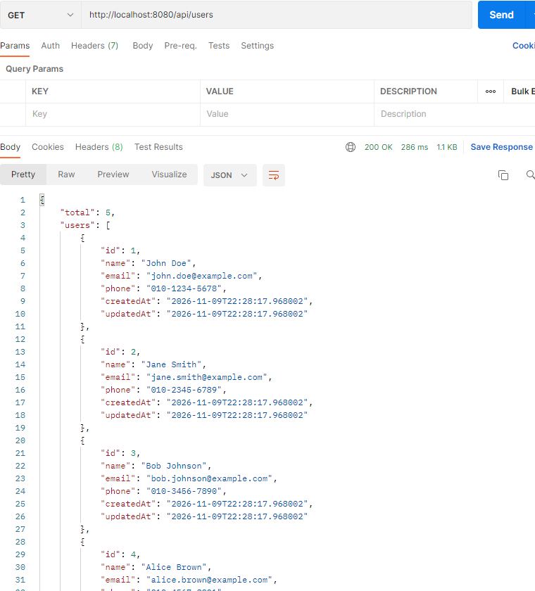
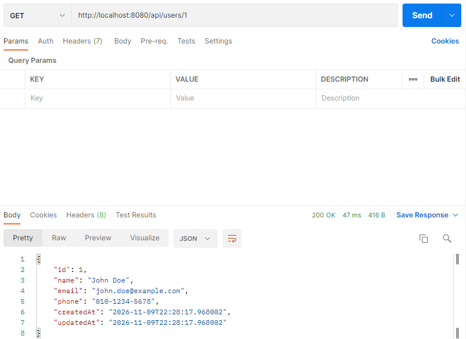
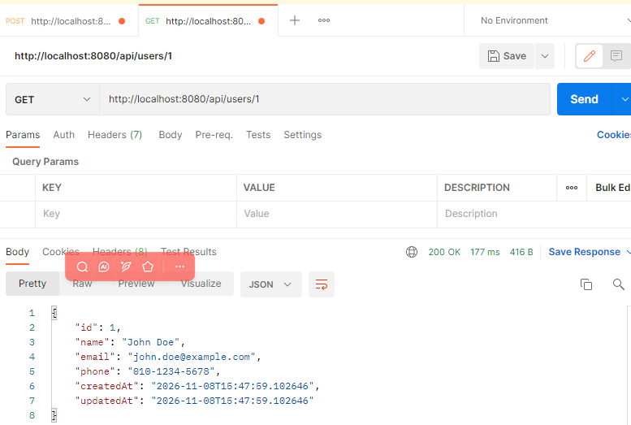
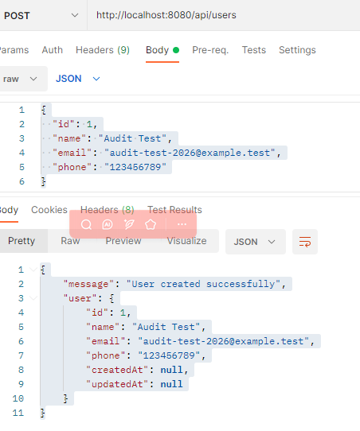
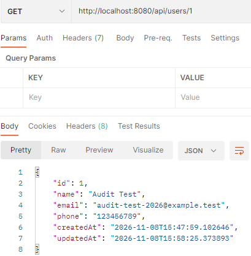
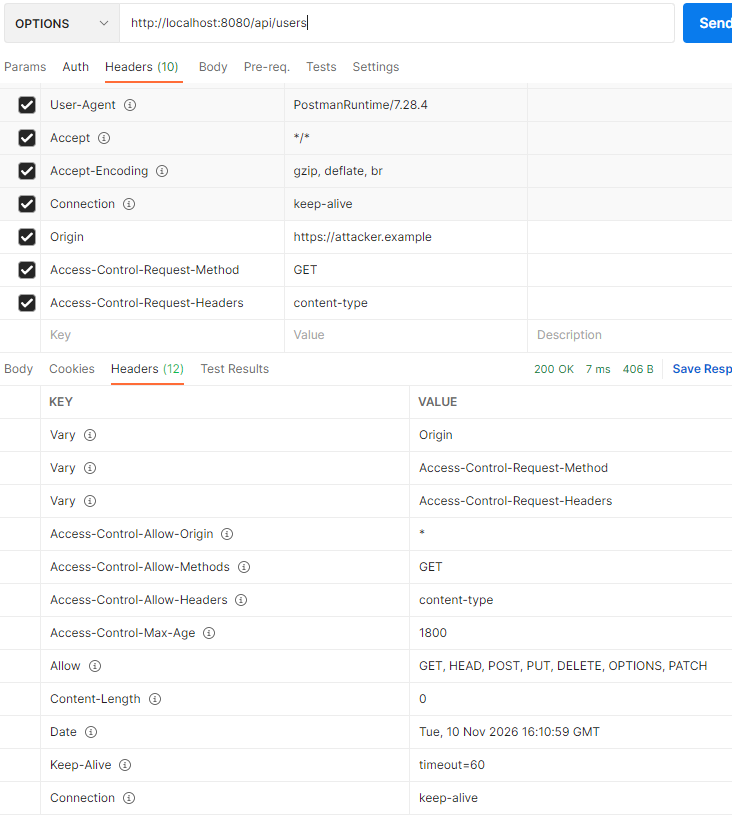
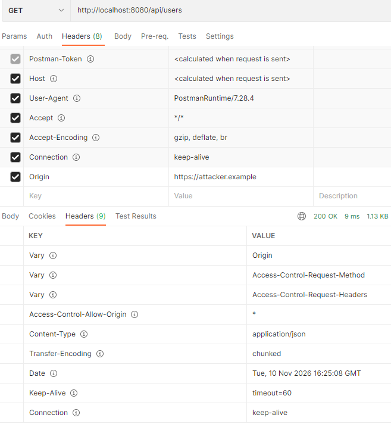
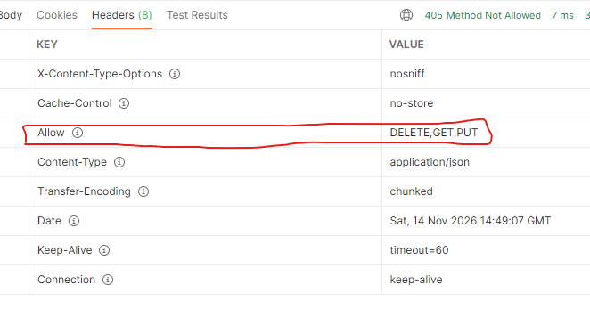

# simple-springboot-crud 第二阶段安全审计总结报告

**项目名称：** simple-springboot-crud
**审计阶段：** 第二阶段安全审计与整改复核

**审计对象：** Spring Boot REST API
**主要测试工具：** Postman、Maven、JUnit、Mockito
**代码仓库：** https://github.com/weikunyuan925-tech/simple-springboot-crud
**审计范围：** 身份认证、访问控制、输入验证、数据完整性、异常处理、搜索安全、分页、请求频率限制、HTTP 安全响应头及配置安全。

**审计日期：** 2026-11-19 至 2026-11-20
**报告修订日期：** 2026-11-20

## 1. 审计概述

本阶段围绕第一阶段发现的安全问题，对 simple-springboot-crud 项目开展了安全整改、代码复核及动态回归测试。

审计内容覆盖用户身份认证、JWT 令牌验证、用户数据归属控制、Mass Assignment、手机号和邮箱校验、搜索接口输入安全、分页机制、请求频率限制、异常处理、JSON 类型转换及 HTTP 安全响应头等方面。

项目已从最初缺少身份认证和访问控制的简单 CRUD API，逐步完善为具有 JWT 身份认证、用户数据归属控制及多项输入安全防护的 API 项目。

本报告依据现有审计测试记录、整改说明及代码复核结果整理。测试结果应区分历史漏洞复现、整改后动态验证、代码静态检查和自动化测试，不能将所有项目统一描述为已完成生产级安全验证。

## 2. 审计整改总体情况

| 编号       | 审计项目                         | 当前记录状态                     | 复核说明                                                     |
| ---------- | -------------------------------- | -------------------------------- | ------------------------------------------------------------ |
| F-01<br /> | 用户接口缺少身份认证             | 核心整改完成                     | JWT 认证已实现                                               |
| F-02       | 创建接口 Mass Assignment         | 已整改                           | 使用独立创建请求 DTO，服务端生成主键                         |
| F-03       | 更新接口缺少身份认证及对象级授权 | 核心整改完成                     | 已引入 owner 数据归属控制，越权测试通过                      |
| F-04       | 删除接口缺少身份认证及对象级授权 | 核心整改完成                     | 已引入 owner 数据归属控制，越权测试通过                      |
| F-05       | CORS 跨域配置过于宽松            | 代码整改完成                     | 已移除通配来源配置；尚未进行真实浏览器跨域验证               |
| F-06       | H2 Console 暴露及弱认证          | 未整改，保留残余风险             | 当前仍存在 H2 Console 启用、sa 空密码及匿名访问配置；仅限本地学习环境，不应部署到生产环境 |
| F-07       | 敏感信息及日志安全               | 部分整改，部分检查完成           | 已移除临时 Hibernate TRACE 配置；源码未发现明显的业务层敏感信息日志调用；其他日志配置及运行环境日志策略尚未全面整改 |
| F-08       | 输入验证与数据完整性审计         | 已整改                           | POST、PUT 非法手机号输入测试通过                             |
| F-09       | 重复邮箱异常处理                 | 整改完成                         | 重复邮箱返回 409                                             |
| F-10       | 更新字段边界及搜索输入安全       | 已整改主要问题                   | 已验证 `%`、`_`、`!` 按普通字符进行搜索；缺少 name 参数返回 400 |
| F-11       | 用户列表和搜索分页               | 已实现并有测试记录               | 已核对当前测试记录与实际代码，保留分页及跨用户隔离验证       |
| F-12       | 用户查询接口缺少限流             | 已实现，单实例适用               | 已记录 429、限流响应头及健康检查豁免；分布式限流未覆盖       |
| F-13       | HTTP 安全响应头缺失              | 已增加响应头配置，动态验证有记录 | 已记录正常及异常响应的安全响应头；HSTS 仍需在 HTTPS 部署环境验证 |
| F-14       | 异常请求及 HTTP 方法处理         | 已整改                           | 405、404、400、415 等异常映射有动态测试记录                  |
| F-15       | JSON 字段类型转换控制不严格。    | 已整改                           | 数字、布尔值、数组、对象等非法类型测试返回 400               |

## 3. 主要安全整改成果

### 3.1 身份认证与访问控制

已引入 Spring Security 和 JWT 身份认证机制。

主要实现包括：

- 用户注册及登录接口。
- BCrypt 密码哈希存储。
- JWT Token 签发和验证。
- Bearer Token 请求认证。
- 无状态 Session 配置。
- 未认证请求返回 HTTP 401。
- 用户业务数据与登录账号建立 owner 归属关系。
- 查询、更新和删除操作按照当前登录用户的数据归属进行限制。
- 创建用户时由服务端设置数据所属账号，避免客户端自行指定 owner。

需要继续保留双账号测试，验证账号 A 无法读取、修改或删除账号 B 的业务数据。

### 3.2 输入验证与数据完整性

已完成的整改包括：

- 创建接口使用独立的 UserCreateRequest。
- 创建时不接受客户端指定数据库主键。
- 手机号统一采用中国大陆 11 位手机号格式校验。
- 邮箱增加格式和最大长度限制。
- 姓名增加长度及非空校验。
- 重复邮箱使用 HTTP 409 返回业务冲突。
- 更新接口不允许通过请求体修改数据库主键和系统维护时间。
- Jackson 严格限制 JSON 非字符串类型向 String 的自动转换。

### 3.3 搜索接口安全

已完成的主要工作：

- 使用 JPQL 参数绑定。
- LIKE 查询对 `%`、`_` 和转义字符进行处理。
- 保留正常姓名模糊搜索功能。
- 增加分页查询。
- 限制分页大小，避免客户端通过超大 size 请求大量数据。

需要注意：参数绑定与 LIKE 通配符转义解决的是不同问题，不能将 LIKE 通配符问题描述为已经发现 SQL 注入。

### 3.4 请求频率限制

已增加 API 限流机制。

当前实现采用进程内固定窗口计数方式，能够在单实例环境中限制指定 API 请求频率，并通过以下响应头提供限流信息：

- X-RateLimit-Limit
- X-RateLimit-Remaining
- Retry-After

超出限制后返回 HTTP 429。

健康检查接口不受该限流规则影响。

当前方案适用于本地学习和单实例测试，不代表已经具备多实例分布式限流能力。

### 3.5 HTTP 响应头及异常处理

已增加统一 HTTP 安全响应头过滤器，记录的整改内容包括：

- X-Content-Type-Options
- X-Frame-Options
- Content-Security-Policy
- Referrer-Policy
- Permissions-Policy
- Cache-Control

全局异常处理方面，针对常见客户端请求错误增加专用处理逻辑，避免将所有异常统一返回 HTTP 500。

主要状态码包括：

- 400 Bad Request
- 401 Unauthorized
- 403 Forbidden
- 404 Not Found
- 405 Method Not Allowed
- 409 Conflict
- 415 Unsupported Media Type
- 429 Too Many Requests

## 4. 当前仍需处理的安全问题

### 4.1 F-06：H2 Console 暴露问题

这是当前最明确的残留配置风险。

现有代码复核发现：

- H2 Console 配置仍为启用状态。
- 数据库使用 sa 用户及空密码。
- SecurityConfig 中仍存在 `/h2-console/**` 匿名放行规则。

即使目前主要用于本地学习，未整改该问题。

**建议：**

1. 默认关闭 H2 Console。
2. 如确有开发调试需求，仅允许在独立开发环境启用。
3. 生产环境禁止启用 H2 Console。
4. 删除生产环境对 `/h2-console/**` 的匿名放行规则。
5. 复测关闭后访问 H2 Console 的结果。

### 4.2 F-13：生产环境 HTTPS 验证尚未完成

HTTP 安全响应头已完成代码整改，并有本地动态测试记录。

但当前尚未建立真实 HTTPS 部署环境，因此 HSTS、反向代理及网关层面的安全响应头仍需在后续部署阶段验证。

## 5. 自动化测试与动态验证证据

本项目采用以下测试方式：

| 测试方式         | 主要验证内容                                              |
| ---------------- | --------------------------------------------------------- |
| 静态代码审查     | Controller、Service、Repository、SecurityConfig、配置文件 |
| Postman 动态测试 | JWT 认证、对象级授权、接口状态码、输入验证、限流及响应头  |
| JUnit 单元测试   | Service 业务逻辑、异常处理及数据访问逻辑                  |
| Mockito          | Repository 交互及业务逻辑隔离测试                         |
| Maven            | 项目编译及自动化测试                                      |

截至本报告整理时，本地 `mvn clean test` 全量测试通过，且相关修改已经提交至 GitHub。

```shell
PS D:\simple-springboot-crud> mvn clean test
......
[INFO] Tests run: 11, Failures: 0, Errors: 0, Skipped: 0, Time elapsed: 3.849 s -- in com.example.crud.controller.UserControllerTest
......
[INFO] Tests run: 1, Failures: 0, Errors: 0, Skipped: 0, Time elapsed: 5.054 s -- in com.example.crud.CrudApplicationTests
......
[INFO] Tests run: 6, Failures: 0, Errors: 0, Skipped: 0, Time elapsed: 0.598 s -- in com.example.crud.repository.UserRepositoryTest
[INFO] Running com.example.crud.service.UserServiceTest
[INFO] Tests run: 9, Failures: 0, Errors: 0, Skipped: 0, Time elapsed: 0.272 s -- in com.example.crud.service.UserServiceTest
[INFO] 
[INFO] Results:
[INFO] 
[INFO] Tests run: 27, Failures: 0, Errors: 0, Skipped: 0
[INFO] 
[INFO] ------------------------------------------------------------------------
[INFO] BUILD SUCCESS
[INFO] ------------------------------------------------------------------------
[INFO] Total time:  21.184 s
[INFO] Finished at: 2026-11-20T23:58:52+08:00
```

本报告不将该反馈描述为本次独立执行的测试结果。正式归档时应保留 Maven 完整控制台输出或 CI 测试记录，作为可复核证据。

## 6. 审计结论

本阶段已经完成项目核心身份认证、用户数据归属控制、输入验证、搜索安全、分页、限流、异常处理和 JSON 类型转换等多项整改。

但目前仍存在以下限制：

1. F-06 H2 Console 配置风险尚未关闭。未整改、仅限本地学习环境、不得部署到生产环境。
2. 本项目尚未完成 HTTPS、生产部署、反向代理、多实例及分布式限流等生产环境验证。

**最终审计判断**：核心安全整改已取得阶段性成果。

## 7. 原始审计测试记录

## F-01：漏洞名称，用户接口缺少身份认证

- 涉及接口：`GET /api/users`
- 涉及接口：`GET /api/users/{id}`
- 代码位置：`UserController.java`
- 代码问题：Controller没有认证或授权检查。
- 影响：攻击者可以通过邮箱查询接口探测邮箱是否注册。
- 测试方式：Postman不携带 Authorization信息直接发送GET请求。
- 测试结果：

| 漏洞编号 | 测试接口              | 匿名请求结果                                                 | 结论                 |
| -------- | --------------------- | ------------------------------------------------------------ | -------------------- |
| VUL-01-1 | `GET /api/users`      | 200，返回全部用户数据 | 确认匿名读取用户列表 |
| VUL-01-2 | `GET /api/users/{id}` | 200，返回指定用户信息 | 确认匿名读取单个用户 |

- 初步结论：确认存在未认证访问问题。
- 潜在影响：用户个人信息泄露。

### 整改措施：

- 引入 Spring Security，配置无状态 JWT 身份认证。

  ```xml
  <!-- JWT API -->
  <dependency>
      <groupId>io.jsonwebtoken</groupId>
      <artifactId>jjwt-api</artifactId>
      <version>0.13.0</version>
  </dependency>
  <!-- JWT implementation -->
  <dependency>
      <groupId>io.jsonwebtoken</groupId>
      <artifactId>jjwt-impl</artifactId>
      <version>0.13.0</version>
      <scope>runtime</scope>
  </dependency>
  <!-- JWT Jackson JSON support -->
  <dependency>
      <groupId>io.jsonwebtoken</groupId>
      <artifactId>jjwt-jackson</artifactId>
      <version>0.13.0</version>
      <scope>runtime</scope>
  </dependency>
  ```

- 新增 `SysUser` 用户认证实体及 Repository。

  SysUser，SysUserRepository

- 使用 BCrypt 对用户密码进行哈希存储。

  ```java
  sysUser.setPassword(passwordEncoder.encode(request.getPassword()));
  ```

- 实现用户注册和登录接口。

  AuthController

​       POST http://localhost:8080/api/auth/register

​       POST http://localhost:8080/api/auth/login

- 登录成功后签发有效期为 15 分钟的 JWT。

  ```java
  return jwtService.generateToken(sysUser.getUsername());
  ```

- 通过 `JwtAuthenticationFilter` 验证请求中的 Bearer Token。

  ```java
  String token = authHeader.substring(7);
  -->
  String username = jwtService.extractUsername(token);
  -->
  if (username != null && SecurityContextHolder.getContext().getAuthentication() == null) 
  -->
  UserDetails userDetails = userDetailsService.loadUserByUsername(username);
  -->
  if (jwtService.isTokenValid(token, userDetails)) 
  -->
  UsernamePasswordAuthenticationToken authentication = new UsernamePasswordAuthenticationToken(userDetails,null,userDetails.getAuthorities());
  -->
  authentication.setDetails(new WebAuthenticationDetailsSource().buildDetails(request));
  -->
  SecurityContextHolder.getContext().setAuthentication(authentication);
  -->    
  filterChain.doFilter(request, response);
  ```

- 未认证请求返回 HTTP 401，认证成功后允许访问受保护接口。

### 复测结果：

| 测试编号 | 测试场景               | 实际结果        |
| -------- | ---------------------- | --------------- |
| JWT-01   | 不携带 Token           | 401，无实体json |
| JWT-02   | 携带错误 Token         | 401，无实体json |
| JWT-03   | 携带过期 Token         | 401，无实体json |
| JWT-04   | 携带有效 Token         | 200，返回数据   |
| JWT-05   | Authorization 格式错误 | 401，无实体json |

### 整改结论：

 核心身份认证测试通过。


## F-02：创建用户接口允许客户端指定主键并修改已有记录

**问题类型：** Mass Assignment / 客户端可控属性 / 数据完整性风险

**关联 CWE：** CWE-915

**涉及文件：**

- UserDTO.java
- UserService.java
- UserController.java

**问题代码：**

```
private User convertToEntity(UserDTO userDTO) {
    User user = new User();
    user.setId(userDTO.getId());
    user.setName(userDTO.getName());
    user.setEmail(userDTO.getEmail());
    user.setPhone(userDTO.getPhone());
    return user;
}
```

**问题原因：**

创建用户接口允许客户端通过 JSON 提交 ID，Service 层将客户端提供的 ID 写入 User Entity，随后调用 JpaRepository.save()。

当客户端提交的 ID 对应数据库中已经存在的用户时，Spring Data JPA 将该实体识别为非新实体，执行 merge 操作，导致已有记录被修改。

**测试结果：**

| get 查询id=1的数据                | post 查询id=1的数据，请求成功                  | get 查询id=1的数据，数据变化                   |
| --------------------------------- | ---------------------------------------------- | ---------------------------------------------- |
|  |  |  |

**安全影响：**

在当前未发现身份认证和权限控制的项目环境下，如果接口对外开放，未认证用户可能通过创建接口修改已有用户记录，造成用户数据被篡改。

**整改建议：**

1. 创建用户使用独立新增的DTO（UserCreateRequest）。
2. 创建的DTO不允许客户端提交ID，直接不用到id。
3. 创建Entity时不调用setId()。
4. 由数据库自动生成主键。
5. 创建接口与更新接口保持独立的数据处理逻辑。

**验证状态：已动态复现。**

**整改状态：重写createUser逻辑，不将id作为传入参数。**

**复测结果：**

1. 创建请求中即使提交 id 字段，也不修改已有记录。
2. 正常创建用户时，由数据库自增长生成新ID。
3. 原有用户信息保持不变。


### F-03：更新用户接口缺少身份认证和访问控制

**问题类型：** Authentication Bypass / Broken Access Control

**涉及接口：** `PUT /api/users/{id}`

**涉及文件：** `UserController.java`、`UserService.java`

**测试方式：** Postman 不携带 Authorization 信息，直接发送 PUT 请求。

**验证状态：** 

| 测试前数据                                                   | 测试结果                                                     |
| ------------------------------------------------------------ | ------------------------------------------------------------ |
| get http://localhost:8080/api/users/1<br />{"id": 1,<br/>  "name": "John Doe",<br/>  "email": "john.doe@example.com",<br/>  "phone": "010-1234-5678",<br/>  "createdAt": "2026-11-09T22:28:17.968002",<br/>  "updatedAt": "2026-11-09T22:28:17.968002"} | 1.PUT http://localhost:8080/api/users/1<br />{"message": "User updated successfully",<br />id": 1,<br/>  "name": "Audit Test",<br/>  "email": "audit-test-2026@example.test",<br/>  "phone": "123456789"}<br />2.GET http://localhost:8080/api/users/1<br />{  "id": 1,<br/>    "name": "Audit Test",<br/>    "email": "audit-test-2026@example.test",<br/>    "phone": "123456789",<br/>    "createdAt": "2026-11-10T22:19:36.834985",<br/>    "updatedAt": "2026-11-10T22:20:31.901616"}<br />3.数据库内容id=1同步修改 |

**安全影响：** 如果匿名请求能够成功修改用户数据，攻击者可能篡改其他用户的信息，影响数据完整性。

**整改建议：**UserService中增加登录账户验证

```java
    // 获取当前登录账号对应的 SysUser
    private SysUser getCurrentOwner() {
        Authentication authentication = SecurityContextHolder.getContext().getAuthentication();
        if (authentication == null || !authentication.isAuthenticated() || authentication.getName() == null) {
            throw new AccessDeniedException("未获取到有效的登录身份");
        }
        return sysUserRepository.findByUsername(authentication.getName()).orElseThrow(() ->
                        new AccessDeniedException("当前登录账号不存在"));
    }
  //随后在每个Service内加入
   SysUser owner = getCurrentOwner();
```

User中创建一个权限所属的字段owner

```java
    // 业务资料所属的登录账号
    @ManyToOne(fetch = FetchType.LAZY, optional = false)
    @JoinColumn(name = "owner_id", nullable = false)
    private SysUser owner;
```

UserRepository数据库查询阶段，用ownerId来去数据库查询数据

```java
// 按所属账号分页查询资料
Page<User> findAllByOwner_IdOrderByCreatedAtDesc(Long ownerId, Pageable pageable);
// 按资料 ID 和所属账号查询，防止跨账号访问
Optional<User> findByIdAndOwner_Id(Long id, Long ownerId);
// 按所属账号和邮箱查询
Optional<User> findByEmailAndOwner_Id(String email, Long ownerId);
// 按所属账号搜索姓名，保留 LIKE 特殊字符转义
@Query("SELECT u FROM User u WHERE u.owner.id = :ownerId AND u.name LIKE :pattern ESCAPE '!'")
Page<User> searchByOwnerIdAndNamePattern(@Param("ownerId") Long ownerId, @Param("pattern") String pattern, Pageable pageable);
```

**复测结果：**增加，删除，更新都要有token才能进行，并且只能操作用户自己的数据。

**整改状态：** 已整改，增加一个识别权限的owner_id。


### F-04：删除用户接口缺少身份认证和访问控制

**问题类型：** Authentication Bypass / Broken Access Control

**涉及接口：** `DELETE /api/users/{id}`

**涉及文件：** `UserController.java`、`UserService.java`

**测试方式：** Postman 不携带 Authorization 信息，直接发送DELETE请求。

**验证状态：** 

| 测试前数据                                                   | 测试结果                                                     |
| ------------------------------------------------------------ | ------------------------------------------------------------ |
| get http://localhost:8080/api/users/1<br />{"id": 1,<br/>  "name": "John Doe",<br/>  "email": "john.doe@example.com",<br/>  "phone": "010-1234-5678",<br/>  "createdAt": "2026-11-09T22:28:17.968002",<br/>  "updatedAt": "2026-11-09T22:28:17.968002"} | 1.DELETE http://localhost:8080/api/users/1<br />{"message": "User deleted successfully","userId": 1}<br />2.GET http://localhost:8080/api/users/1<br />{"error": "Not Found",<br/>    "message": "User not found with id: 1",<br/>    "timestamp": "2026-11-10T23:32:23.5482727",<br/>    "status": 404}<br />3.数据库内容id=1同步被删除 |

**安全影响：** 如果匿名请求能够成功删除用户数据，攻击者可能篡改其他用户的信息，影响数据完整性。

**复测结果：**增加，删除，更新都要有token才能进行，并且只能操作用户自己的数据。

**整改状态：** 与F03一同整改。


### F-05：CORS 跨域策略配置过于宽松

**问题类型：** CORS Misconfiguration

**涉及接口：** `/api/users/**`

**涉及文件：** `UserController.java`

**问题代码：**

```
@CrossOrigin(origins = "*")
```

**测试结果：**

| 测试 <br />Origin：https://attacker.example      | 发送请求及响应        | 实际结果（检查服务器返回的 CORS 响应头）                     |
| ------------------------------------------------ | --------------------- | ------------------------------------------------------------ |
| 使用 Postman 发送 OPTIONS 预检请求               |  | Access-Control-Allow-Origin: * <br />Access-Control-Allow-Methods: GET <br />Access-Control-Allow-Headers: content-type <br />Access-Control-Max-Age: 1800<br />表明服务器对来自 `https://attacker.example` 的 GET 跨域预检请求返回了允许任意来源的策略。 |
| 使用 Postman 发送携带恶意模拟 Origin 的 GET 请求 |  | Access-Control-Allow-Origin: *<br />表示浏览器可以允许来自任意 Origin 的网页 JavaScript 读取这个响应（还需要满足其他 CORS 条件） |

**安全影响：** 如果服务器允许不受信任的来源读取 API 响应，可能扩大跨域数据暴露风险。实际影响取决于接口数据、浏览器凭据策略及其他访问控制措施。

**整改状态：代码整改完成，API 回归测试通过。**

| 测试编号 | 测试内容          | 实际结果         | 结论 |
| -------- | ----------------- | ---------------- | ---- |
| F05-01   | 有效 JWT 查询用户 | 200 OK           | 通过 |
| F05-02   | 无 JWT 查询用户   | 401 Unauthorized | 通过 |
| F05-03   | 有效 JWT 创建用户 | 201 Created      | 通过 |

**整改内容**：

- 删除 `UserController` 上的 `@CrossOrigin(origins = "*")`。
- 检查 `@CrossOrigin`、`CorsConfigurationSource`、`addCorsMappings`，本地均无搜索结果。
- 未添加不必要的 CORS 配置。
- Postman 的正常 API 请求不受影响。

**审计报告结论**：

F-05 原问题是 CORS 配置允许任意来源跨域访问 API。由于项目没有独立前端，仅提供 Spring Boot API，已删除全局通配来源配置。经 Postman 回归测试，认证查询、匿名访问控制及新增用户功能均符合预期。目前完成的是代码整改和 API 回归测试，并未通过真实浏览器验证 CORS 响应头。因此报告中不要声称已完成浏览器跨域安全测试。


### F-06：H2 Console 管理界面暴露及数据库弱认证风险

**问题类型：** Sensitive Administrative Interface Exposure / Weak Database Authentication

**涉及配置文件：** `application.properties`

**管理接口：** `/h2-console`

**数据库连接地址：** `jdbc:h2:mem:auditdb`

**问题配置：**

```properties
spring.datasource.username=sa
spring.datasource.password=

spring.h2.console.enabled=true
spring.h2.console.path=/h2-console
```

**静态审计结果：**

1. H2 Console 已启用。
2. 数据库使用默认用户名 `sa`。
3. 数据库密码为空。
4. H2 Console 未配置独立的远程访问参数。

**动态测试方式：**

1. 浏览器访问 `http://localhost:8080/h2-console`。
2. 使用 `sa` 用户和空密码登录。
3. 使用 `jdbc:h2:mem:auditdb` 连接数据库。内存模式。
4. 执行只读 SQL，检查数据库用户、Schema 和表结构。

**动态测试结果：**

| 测试项目            | 实际结果                                                     |
| ------------------- | ------------------------------------------------------------ |
| H2 Console 是否启用 | 可以访问                                                     |
| 数据库用户名        | SA                                                           |
| 空密码登录          | 成功                                                         |
| 当前数据库用户      | SA                                                           |
| 当前 Schema         | PUBLIC                                                       |
| 应用数据库表        | USERS                                                        |
| 其他计算机能否访问  | 在全局搜索<br />web-allow-others<br/>SPRING_H2_CONSOLE_SETTINGS_WEB_ALLOW_OTHERS<br/>spring.profiles.active<br />未发现有相关的输出，远程未发现显式开启配置 |

**安全影响：**

H2 Console 提供数据库管理能力。如果管理入口对不可信用户开放，且数据库使用空密码，攻击者可能获得数据库访问权限，导致用户数据泄露、篡改或删除。

**验证结论：**

已确认本机能够访问 H2 Console，并使用 SA 空密码连接数据库。远程不可访问。

**整改建议：**

1. 非开发环境关闭 H2 Console。
2. 数据库设置强密码，不使用空密码。
3. 限制数据库管理界面的访问范围。
4. 避免在生产环境启用 H2 Console。

**风险接受说明：**

本项目当前主要用于本地安全审计学习，暂时保留 H2 Console 配置，以满足本地调试需求。但该配置不具备生产环境安全使用条件。

主要风险包括：

1. H2 Console 处于启用状态。
2. 数据库使用 sa 用户且密码为空。
3. SecurityConfig 存在 `/h2-console/**` 匿名放行规则。

**使用限制：**

- 仅允许在本地隔离的开发环境使用。
- 不得将当前 H2 Console 配置直接部署到公网或生产环境。
- 后续部署生产环境前，必须关闭 H2 Console，并移除对应的匿名放行规则。
- 如果需要继续使用 H2 Console，应通过独立开发环境配置控制启用状态。

**最终结论：** 本项未完成安全整改，属于已识别但暂时接受的残余风险，不得计入已修复漏洞数量。


## F-07：敏感信息泄露与日志安全审计

### F-07-01：API 响应包含用户个人信息

**问题类型：** Sensitive Information Exposure / Broken Access Control

**涉及接口：**GET `/api/users`、GET `/api/users/{id}`

**涉及文件：** UserController.java、UserDTO.java、UserService.java

**测试方式：**使用 Postman 不携带 Authorization 信息，直接请求用户查询接口。

| 测试方式                              | **测试结果**                                                 |
| ------------------------------------- | ------------------------------------------------------------ |
| GET http://localhost:8080/api/users   | 匿名用户可以读取全部用户列表，返回数据包含姓名、邮箱及手机号 |
| GET http://localhost:8080/api/users/1 | 匿名用户可以根据 ID 查询指定用户，返回数据包含姓名、邮箱及手机号 |

**代码审计结果：**

UserDTO 当前包含：id、name、email、phone、createdAt、updatedAt，未发现 password、passwordHash、token 等认证凭据字段。

Controller 通过 UserService 将 Entity 转换为 UserDTO 返回，目前未发现直接返回 User Entity 的情况。

**安全影响：**

未认证用户可以获取用户姓名、邮箱和手机号等个人信息，造成未经授权的个人信息泄露。

**漏洞根因：**

主要根因是 F-01 已确认的身份认证和访问控制缺失，而不是 DTO 本身包含密码字段。

**整改建议：**

1. 对用户查询接口实施身份认证和访问控制。
2. 根据用户角色限制用户列表及单个用户信息的读取范围。
3. 遵循最小必要原则，减少不必要的个人信息返回。
4. 对敏感个人信息实施必要的访问限制或脱敏。

**整改状态：** 已通过 JWT 身份认证及 owner 数据归属控制实施访问限制。该项整改与 F-01、F-03 的认证和对象级授权整改相对应。但当前 UserDTO 仍包含姓名、邮箱和手机号字段。是否需要进一步减少返回字段或实施手机号脱敏，应根据实际业务需求另行评估。因此，本次整改主要解决未授权访问问题，不代表已经完成全部个人信息最小化处理。

### F-07-02：Hibernate SQL 参数日志可能泄露用户个人信息

**问题类型：** Sensitive Information Exposure / Excessive Logging

**关联 CWE：** CWE-532

**涉及配置：** application.properties

**原始日志配置：**

```
spring.jpa.show-sql=true
logging.level.org.hibernate.SQL=DEBUG
logging.level.org.hibernate.type.descriptor.sql.BasicBinder=TRACE
```

**环境确认：**

项目使用 Hibernate ORM 6.3.1.Final。

原有 BasicBinder 日志类别没有显示实际绑定参数值。经确认，当前 Hibernate 版本对应的 JDBC 参数日志类别为：

```
org.hibernate.orm.jdbc.bind
```

**动态测试方式：**

在本地测试环境临时开启：

```
logging.level.org.hibernate.orm.jdbc.bind=TRACE
```

使用 Postman 创建虚构测试用户，观察 IntelliJ IDEA 控制台日志。

```json
{
  "name": "Log Audit Test",
  "email": "log-audit@example.test",
  "phone": "000000000"
}
```

**实际测试结果：**

日志成功输出：

```
binding parameter (2:VARCHAR) <- [log-audit@example.test]
binding parameter (3:VARCHAR) <- [Log Audit Test]
binding parameter (4:VARCHAR) <- [000000000]
```

同时还记录了创建时间和更新时间。

**结论：**

已经动态证明，在开启 Hibernate JDBC 参数绑定 TRACE 日志后，SQL 参数的实际值会进入日志输出。

但是，本次使用的是临时测试配置，尚未证明原始运行环境在默认配置下就会记录这些参数。

**安全影响：**

如果生产环境启用参数绑定 TRACE，具有日志读取权限的人员可能获得用户姓名、邮箱、手机号等个人信息。

**整改建议：**

1. 生产环境禁止开启 Hibernate JDBC 参数绑定 TRACE。
2. 避免在日志中记录密码、Token 和其他认证凭据。
3. 限制日志文件访问权限。
4. 设置合理的日志保留及清理策略。
5. 关闭不必要的 SQL 调试输出。

**整改状态：**确认临时TRACE配置已移除，其他日志类暂不整改，该系统学习使用。


### F-07-03：业务代码主动记录敏感信息检查

**问题类型：** Sensitive Information Logging

**检查方式：**

使用 IntelliJ IDEA 全项目搜索：System.out.println、System.err.println、printStackTrace、log.info、log.warn、log.error、log.debug、logger.info、logger.warn、logger.error、LoggerFactory、org.slf4j.Logger、@Slf4j、@Log4j2、java.util.logging

**测试结果：**

未发现业务代码主动记录用户密码、Token 或个人信息的日志调用。

**结论：**

当前项目源码中未发现明显的业务层敏感信息日志记录行为，该结论不代表第三方依赖或运行环境产生的日志不存在敏感信息。

**验证状态：** 已完成源码搜索。

**审计结论：** 暂未发现。


### F-07-04：异常响应暴露内部信息检查

**涉及文件：** GlobalExceptionHandler.java

**检查内容：**

1. 用户不存在异常。
2. 参数校验异常。
3. 通用 Exception 异常。

**测试一：查询不存在的用户 ID**

GET http://localhost:8080/api/users/7

```json
实际响应：
{
  "error": "Not Found",
  "message": "User not found with id: 7",
  "timestamp": "2026-11-11T19:55:23.8404758",
  "status": 404
}
```

**测试二：查询不存在的邮箱**

GET http://localhost:8080/api/users/email/notexist-audit@example.test

```json
实际响应：
{
  "error": "Not Found",
  "message": "User not found with email: notexist-audit@example.test",
  "timestamp": "2026-11-11T19:56:12.7134105",
  "status": 404
}
```

**测试三：提交非法参数**

PUT http://localhost:8080/api/users/1

```json
实际响应：
{
    "error": "Validation Failed",
    "errors": {
        "name": "Name is required"
    },
    "timestamp": "2026-11-11T22:25:56.2018304",
    "status": 400
}
```

**代码审计结果：**

用户不存在异常处理使用：

```java
ex.getMessage()
```

将异常消息直接返回客户端。

通用异常处理使用固定错误消息：

```
An unexpected error occurred
```

没有直接返回完整异常堆栈或异常原文。

**测试结论：**

1. 未发现异常堆栈直接返回客户端。
2. 未发现 SQL 语句直接暴露。
3. 未发现服务器本地路径直接暴露。
4. 用户不存在异常会回显请求中的 ID 或邮箱。
5. 参数校验异常仅返回字段校验信息。

**安全影响：**

错误消息回显可能泄露用户标识或邮箱输入信息。结合邮箱查询接口，存在辅助邮箱枚举的风险，目前尚未完成已存在邮箱与不存在邮箱的完整对照测试，因此不将邮箱枚举记为已完全动态确认的独立漏洞。

**整改建议：**

1. 避免将内部异常原文直接返回客户端。
2. 对外使用统一、适当的错误消息。
3. 服务端保留必要的异常日志，避免记录敏感信息。
4. 对用户查询接口实施身份认证与访问控制。

**验证状态：** 已完成异常响应动态检查。

**审计结论：** 未发现明显的高风险异常信息泄露。


### F-07 总体整改结论：

**整改及验证情况：**

1. 已检查业务代码中的日志调用，未发现明显主动记录用户密码、Token 或个人信息的业务日志。
2. 已通过临时开启 Hibernate JDBC 参数绑定 TRACE，验证 SQL 参数值可能进入日志输出。
3. 已确认临时 Hibernate TRACE 测试配置已移除。
4. 其他日志配置、日志文件访问权限及日志保留策略尚未进行全面整改。

**整改状态：部分整改，部分检查完成。**

**残余风险：**

生产环境应禁止开启 Hibernate JDBC 参数绑定 TRACE，避免密码、Token、邮箱、手机号等敏感信息进入日志；同时应限制日志文件访问权限，并制定合理的日志保留及清理策略。

**最终结论：** 当前未发现明显的业务代码主动记录敏感信息行为，但不能据此认定整个应用及运行环境不存在敏感信息日志风险。


## F-08：输入验证与数据完整性审计

### F-08-01：中国大陆手机号输入验证不足

原有手机号校验主要依靠以下方式，无法验证手机号是否符合中国大陆号码格式。

```java
@Size(max = 15)@NotBlank(message = "Phone number is required")
private String phone;
```

动态测试发现，以下非法输入能够通过更新接口：`11aa`、`068+123`，说明原有校验规则无法有效限制手机号格式，可能导致不符合业务要求的数据进入数据库。

### 整改目标：

本项目统一采用中国大陆手机号码格式，不支持国际号码。

手机号校验要求：

1. 手机号必填。
2. 必须为 11 位。
3. 只能包含数字。
4. 第一位必须为 1。
5. 第二位必须为 3～9。
6. 不允许空格、字母及其他特殊字符。
7. 不允许使用 `+86` 国际区号。
8. POST 和 PUT 使用完全一致的校验规则。

统一正则表达式：

```java
^1[3-9][0-9]{9}$
```

### 整改方案：

分别修改 UserCreateRequest.java 和 UserDTO.java。

统一使用：

```java
@NotBlank(message = "请输入手机号")
@Pattern(
    regexp = "^1[3-9][0-9]{9}$",
    message = "请输入有效的11位中国大陆手机号码，13-19开头"
)
private String phone;
```

并导入：

```
import jakarta.validation.constraints.NotBlank;
import jakarta.validation.constraints.Pattern;
```

删除原有手机号字段的：

```
@Size(max = 15)
```

两个DTO使用相同的校验规则，保证创建和更新接口的行为一致。

### 回归测试结果：

### POST 创建接口测试

**测试接口：** `POST /api/users`，使用 UserCreateRequest 接收请求参数。

| 测试内容   | 测试输入         | 结果     | 实际结论                                                     |
| ---------- | ---------------- | -------- | ------------------------------------------------------------ |
| 合法手机号 | 13812345678      | HTTP 201 | {    "message": "User created successfully",<br/>    "user": {<br/>        "id": 11,<br/>        "name": "Audit!A Test",<br/>        "email": "f09111111-concusrrent@example.test",<br/>        "phone": "13812345678",<br/>        "createdAt": "2026-11-20T23:51:45.5821853",<br/>        "updatedAt": "2026-11-20T23:51:45.5821853"<br/>    }<br/>} |
| 空字符串   | `""`             | HTTP 400 | {   "error": "Validation Failed",<br/>    "errors": {<br/>        "phone": "请输入有效的11位中国大陆手机号码，13-19开头"<br/>    },<br/>    "timestamp": "2026-11-12T01:15:05.9424103",<br/>    "status": 400} |
| null       | `null`           | HTTP 400 | 同上                                                         |
| 纯空格     | `"   "`          | HTTP 400 | 同上                                                         |
| 包含字母   | `11aa`           | HTTP 400 | 同上                                                         |
| 特殊字符   | `068+123`        | HTTP 400 | 同上                                                         |
| 国际区号   | `+8613812345678` | HTTP 400 | 同上                                                         |
| 长度不足   | `1381234567`     | HTTP 400 | 同上                                                         |
| 长度超出   | `138123456789`   | HTTP 400 | 同上                                                         |
| 不合法号段 | `12812345678`    | HTTP 400 | 同上                                                         |
| 包含空格   | `138 1234 5678`  | HTTP 400 | 同上                                                         |

**数据库验证：**

非法 POST 请求均未产生新增用户记录；合法 POST 请求能够正常创建用户，数据库保存的手机号符合要求。

### PUT 更新接口测试

**测试接口：** `PUT /api/users/{id}`，使用 UserDTO 接收请求参数。

| 测试内容   | 测试输入         | 结果     | 实际结论                                                     |
| ---------- | ---------------- | -------- | ------------------------------------------------------------ |
| 合法手机号 | 13423446789      | HTTP 200 | {    "message": "User updated successfully",<br/>    "user": {<br/>        "id": 1,<br/>        "name": "Audit Test",<br/>        "email": "audittest2026@example.test",<br/>        "phone": "13423446789",<br/>        "createdAt": "2026-11-20T23:48:24.190405",<br/>        "updatedAt": "2026-11-20T23:48:24.190405"<br/>    }<br/>} |
| 空字符串   | `""`             | HTTP 400 | {  "error": "Validation Failed",<br/>    "errors": {<br/>        "phone": "请输入有效的11位中国大陆手机号码，13-19开头"<br/>    },<br/>    "timestamp": "2026-11-12T01:17:05.4592862",<br/>    "status": 400 } |
| null       | `null`           | HTTP 400 | 同上                                                         |
| 纯空格     | `"   "`          | HTTP 400 | 同上                                                         |
| 包含字母   | `11aa`           | HTTP 400 | 同上                                                         |
| 特殊字符   | `068+123`        | HTTP 400 | 同上                                                         |
| 国际区号   | `+8613812345678` | HTTP 400 | 同上                                                         |
| 长度不足   | `1381234567`     | HTTP 400 | 同上                                                         |
| 长度超出   | `138123456789`   | HTTP 400 | 同上                                                         |
| 不合法号段 | `12812345678`    | HTTP 400 | 同上                                                         |
| 包含空格   | `138 1234 5678`  | HTTP 400 | 同上                                                         |

**数据库验证：**非法 PUT 请求未修改原有用户记录；合法 PUT 请求能够正常更新用户信息。


### F-08-02：DTO 参数校验有效性检查

**涉及文件：**UserDTO.java、UserCreateRequest.java、UserController.java、GlobalExceptionHandler.java

**测试接口：**

#### POST `/api/users`

| 测试项目       | 输入情况                 | 实际状态码 | 结果                                                         |
| -------------- | ------------------------ | ---------- | ------------------------------------------------------------ |
| 姓名           | 1 个字符                 | 400        | {   "error": "Validation Failed",<br/>    "errors": {<br/>        "name": "Name is required"<br/>    },<br/>    "timestamp": "2026-11-11T21:02:22.1227902",<br/>    "status": 400 } |
| 邮箱           | 非法邮箱格式             | 400        | {   "error": "Validation Failed",<br/>    "errors": {<br/>        "email": "Email should be valid"<br/>    },<br/>    "timestamp": "2026-11-11T21:02:37.6559977",<br/>    "status": 400 } |
| 手机号         | 超过 15 个字符           | 400        | {    "error": "Validation Failed",<br/>    "errors": {<br/>        "phone": "请输入有效的11位中国大陆手机号码，13-19开头"<br/>    },<br/>    "timestamp": "2026-11-20T23:53:14.3613795",<br/>    "status": 400<br/>} |
| 多字段联合错误 | 姓名、邮箱、手机号均非法 | 400        | {    "error": "Validation Failed",<br/>    "errors": {<br/>        "phone": "请输入有效的11位中国大陆手机号码，13-19开头",<br/>        "name": "个数必须在2和100之间",<br/>        "email": "不是一个合法的电子邮件地址"<br/>    },<br/>    "timestamp": "2026-11-20T23:53:57.100494",<br/>    "status": 400<br/>} |

#### PUT `/api/users/{id}`

| 测试项目         | 输入情况      | 实际状态码 | 数据库变化 | 结果                                                         |
| ---------------- | ------------- | ---------- | ---------- | ------------------------------------------------------------ |
| 姓名为空         | 违反 NotBlank | 400        | 无变化     | {    "error": "Validation Failed",<br/>    "errors": {<br/>        "name": "Name is required"<br/>    },<br/>    "timestamp": "2026-11-20T23:55:24.0652585",<br/>    "status": 400<br/>} |
| 邮箱格式错误     | 违反 Email    | 400        | 无变化     | {    "error": "Validation Failed",<br/>    "errors": {<br/>        "email": "Email should be valid"<br/>    },<br/>    "timestamp": "2026-11-20T23:54:51.184316",<br/>    "status": 400<br/>} |
| 手机号超过 15 位 | 违反 Size     | 400        | 无变化     | {    "error": "Validation Failed",<br/>    "errors": {<br/>        "phone": "请输入有效的11位中国大陆手机号码，13-19开头"<br/>    },<br/>    "timestamp": "2026-11-20T23:54:31.0496207",<br/>    "status": 400<br/>} |

#### 姓名长度边界测试，PUT `/api/users/{id}`

UserDTO 中姓名校验规则：

```java
@Size(min = 2, max = 100)
```

| 测试编号 | 姓名长度 | 实际结果 | 数据库变化 | 结果                                                         |
| -------- | -------- | -------- | ---------- | ------------------------------------------------------------ |
| BOUND-01 | 1        | HTTP 400 | 无变化     | {   "error": "Validation Failed",<br/>    "errors": {<br/>        "name": "Name must be between 2 and 100 characters"<br/>    },<br/>    "timestamp": "2026-11-11T21:06:01.5737046",<br/>    "status": 400 } |
| BOUND-02 | 2        | HTTP 200 | 更新成功   | {   "message": "User updated successfully",<br/>    "user": {<br/>        "id": 1,<br/>        "name": "AB",<br/>        "email": "audittest2026@example.test",<br/>        "phone": "13345688789",<br/>        "createdAt": "2026-11-11T19:23:11.724232",<br/>        "updatedAt": "2026-11-11T19:23:11.724232"<br/>    }} |
| BOUND-03 | 100      | HTTP 200 | 更新成功   | {   "message": "User updated successfully",<br/>    "user": {<br/>        "id": 1,<br/>        "name": "qwertqwertqwertqwertqwertqwertqwertqwertqwertqwertqwertqwertqwertqwertqwertqwertqwertqwertqwertqwert",<br/>        "email": "audittest2026@example.test",<br/>        "phone": "13345678898",<br/>        "createdAt": "2026-11-11T19:23:11.724232",<br/>        "updatedAt": "2026-11-11T21:06:21.266002"<br/>    }} |
| BOUND-04 | 101      | HTTP 400 | 无变化     | {   "error": "Validation Failed",<br/>    "errors": {<br/>        "name": "Name must be between 2 and 100 characters"<br/>    },<br/>    "timestamp": "2026-11-11T21:08:59.1405845",<br/>    "status": 400 } |

**测试结论：**

POST 和 PUT 接口的基本参数校验均正常工作，姓名长度的最小值和最大值边界均符合预期，非法 PUT 请求没有改变数据库记录。

**验证状态：** 已动态验证。

**审计结论：** 基础校验通过。


### 最终结论：F-08 整改通过。


## F-09：重复邮箱触发数据库唯一约束异常，但全局异常处理不完善。

### 问题基本信息

- **问题类型：** Improper Error Handling / Database Constraint Handling
- **涉及接口：** POST `/api/users`
- **涉及文件：** User.java、UserRepository.java、UserService.java、GlobalExceptionHandler.java

### 问题描述：

重复使用相同邮箱提交 POST 注册请求时，数据库因邮箱唯一约束拒绝插入，但全局异常处理器将该异常作为普通内部异常处理，返回 HTTP 500。

实际响应

```json
{ "error": "Internal Server Error",   
  "message": "An unexpected error occurred",   
  "timestamp": "2026-11-12T01:03:12.2960168",   
  "status": 500 } 
```

### 定位原因：

因为user.java中邮箱字段设置了唯一约束，数据库正确拒绝了重复邮箱，但应用没有对重复邮箱进行提前检查，也没有为相关异常提供专门的处理逻辑。

```java
@Column(nullable = false, unique = true)
private String email;
```

### 整改目标：

1.重复邮箱提前检查

2.返回 HTTP 409

3.保留数据库唯一约束

4.不向客户端暴露数据库内部异常信息

5.确认重复请求不会产生新的数据库记录。

### 修改代码：

1.新建一个EmailAlreadyExistsException异常类

```java
public class EmailAlreadyExistsException extends RuntimeException {
    public EmailAlreadyExistsException(String message) {
        super(message);
    }
}
```

2.在create数据时先校验email是否存在

```java
if (userRepository.existsByEmail(request.getEmail())) {
    throw new EmailAlreadyExistsException("邮箱已注册");
}
```

3.在GlobalExceptionHandler.java中统一管理异常类返回

```java
@ExceptionHandler(EmailAlreadyExistsException.class)
public ResponseEntity<Map<String, Object>> handleEmailAlreadyExists(
        EmailAlreadyExistsException ex) {
    Map<String, Object> errorResponse = new HashMap<>();
    errorResponse.put("timestamp", LocalDateTime.now());
    errorResponse.put("status", HttpStatus.CONFLICT.value());
    errorResponse.put("error", "Conflict");
    errorResponse.put("message", ex.getMessage());
    return new ResponseEntity<>(
            errorResponse,
            HttpStatus.CONFLICT
    );
}
```

### 测试：

POST http://localhost:8080/api/users，再次创建同一个邮箱的信息时返回

```json
{ "error": "Conflict",
    "message": "邮箱已注册",
    "timestamp": "2026-11-12T01:35:05.5159944",
    "status": 409
}
```

数据库数据没有新增。

### 用jmeter并发测试：

| 测试项目     | 实际结果     | 判定 |
| ------------ | ------------ | ---- |
| 并发请求总数 | 20           | —    |
| 创建成功     | 1 次（201）  | 通过 |
| 重复邮箱拒绝 | 19 次（409） | 通过 |
| 服务器错误   | 0 次（500）  | 通过 |
| 认证失败     | 0 次（401）  | 通过 |

### 最终结论：F-09 的主要整改已经完成。


## F-10：更新接口字段边界与搜索接口输入安全审计

### 基本信息

**审计模块：** 用户更新接口、用户搜索接口

**涉及文件：**UserController.java、UserService.java、UserRepository.java、UserDTO.java、UserCreateRequest.java、User.java

**审计方式：** 静态代码审查、动态请求测试、数据库记录核对

### Email邮箱格式及长度边界测试

#### 1.1原始代码检查

原 DTO 校验规则：

```java
@NotBlank(message = "Email is required")
@Email(message = "Email should be valid")
private String email;
```

数据库查询结果：

```sql
EMAIL
CHARACTER VARYING(255)
```

发现 DTO 原先没有明确的邮箱最大长度限制，而数据库字段最大长度为 255。

#### 1.2 整改内容

在 UserCreateRequest.java 和 UserDTO.java 中统一增加：

```
@Size(max = 255, message = "邮箱长度不能超过255个字符")
```

确保创建和更新接口采用相同的邮箱长度限制。

#### 1.3 动态测试

使用 PUT 更新接口测试：

| 测试内容     | 输入                                                         | 实际结果                                                     |
| ------------ | ------------------------------------------------------------ | ------------------------------------------------------------ |
| 空字符串     | ""                                                           | {<br/>    "error": "Validation Failed",<br/>    "errors": {<br/>        "email": "Email is required"<br/>    },<br/>    "timestamp": "2026-11-12T14:34:49.7673018",<br/>    "status": 400<br/>} |
| null         | null                                                         | {<br/>    "error": "Validation Failed",<br/>    "errors": {<br/>        "email": "Email should be valid"<br/>    },<br/>    "timestamp": "2026-11-12T14:35:04.0671388",<br/>    "status": 400<br/>} |
| 空格         | "   "                                                        | 同上                                                         |
| 非法邮箱     | invalid-email                                                | 同上                                                         |
| 缺少域名     | user@                                                        | 同上                                                         |
| 缺少邮箱名称 | @example.test                                                | 同上                                                         |
| 双 @ 符号    | user@@example.test                                           | 同上                                                         |
| 包含空格     | user [name@example.test](mailto:name@example.test)           | 同上                                                         |
| 合法邮箱     | [f10-valid@example.test](mailto:f10-valid@example.test)（数据库不重复的邮箱） | HTTP 200，更新成功                                           |
| 合法邮箱     | [f101-valid@example.test](mailto:f10-valid@example.test)（数据库重复的邮箱） | {<br/>    "error": "Conflict",<br/>    "message": "邮箱已注册",<br/>    "timestamp": "2026-11-12T14:37:30.9847093",<br/>    "status": 409<br/>} |

#### 1.4 邮箱长度边界

| 测试编号 | 邮箱长度 | 实际结果                                                     |
| -------- | -------- | ------------------------------------------------------------ |
| EMAIL-10 | 255 字符 | HTTP 200，成功写入                                           |
| EMAIL-11 | 256 字符 | {<br/>    "error": "Validation Failed",<br/>    "errors": {<br/>        "email": "邮箱长度不能超过255个字符"<br/>    },<br/>    "timestamp": "2026-11-12T14:48:58.538081",<br/>    "status": 400<br/>} |

POST 和 PUT 两个接口均完成了对应的 255/256 字符测试，结果符合预期。

#### 1.5 测试结论

邮箱格式校验和最大长度限制正常，255 字符可以通过，256 字符被拒绝。

**状态：测试通过。**

### 2. Name 姓名字段边界与特殊字符测试

#### 2.1 原始校验规则

```
@NotBlank
@Size(min = 2, max = 100)
private String name;
```

#### 2.2 POST 动态测试

| 测试编号 | 姓名输入                  | 实际结果                                                     |
| -------- | ------------------------- | ------------------------------------------------------------ |
| NAME-01  | 两个空格                  | {<br/>    "error": "Validation Failed",<br/>    "errors": {<br/>        "name": "不能为空"<br/>    },<br/>    "timestamp": "2026-11-12T14:59:22.7327538",<br/>    "status": 400<br/>} |
| NAME-02  | 张三                      | 创建成功                                                     |
| NAME-03  | O'Connor                  | 创建成功                                                     |
| NAME-04  | 李-明                     | 创建成功                                                     |
| NAME-05  | <script>alert(1)</script> | 创建成功                                                     |
| NAME-06  | ' OR '1'='1               | 创建成功                                                     |

实际测试创建了以下测试记录：

- ID=8：张三
- ID=9：O'Connor
- ID=10：李-明
- ID=11：<script>alert(1)</script>
- ID=12：' OR '1'='1

#### 2.3 PUT 动态测试

| 测试编号 | 姓名输入                  | 实际结果 |
| -------- | ------------------------- | -------- |
| 1        | O'Connor                  | 更新成功 |
| 2        | <script>alert(1)</script> | 更新成功 |
| 3        | ' OR '1'='1               | 更新成功 |

#### 2.4 安全分析

**HTML/XSS 输入：**

能够保存 `<script>alert(1)</script>`，仅证明服务端允许该字符串进入数据库。

当前没有验证浏览器前端是否使用不安全的 HTML 渲染方式，因此不能认定已经存在存储型 XSS。

**SQL 注入特征字符串：**

能够保存 `' OR '1'='1`，不代表数据库执行了 SQL 代码。

后续结合搜索接口 SQL 注入测试，未发现该字符串被执行为 SQL 条件的证据。

**中文、英文姓名及连字符：**

测试均正常，未发现不合理拒绝。

#### 2.5 测试结论

当前姓名字段长度及非空校验正常。

特殊字符能够作为普通字符串保存，没有发现已确认的 XSS 或 SQL 注入漏洞。

不过，前端输出编码仍需结合实际页面单独审计。

**状态：未发现明确漏洞。**

### 3. PARAM-01：客户端篡改 JSON ID 测试

#### 3.1 测试目的

验证客户端提交的 JSON ID 是否会影响 PUT 接口实际更新的目标记录。

#### 3.2 测试方式

```
发送 PUT /api/users/20
```

JSON 请求体提交：

```
{
  "id": 21,
  "name": "F10 ID Tampered",
  "email": "f10-id-a@example.test",
  "phone": "13812345678"
}
```

其中：URL ID 为 20；JSON ID 为 21。

#### 3.3 实际测试结果

测试发现：

1. 修改的是 URL 中 ID=20 对应的记录。
2. JSON 中的 ID=21 不影响更新目标。
3. ID=21 对应的记录没有因为 JSON ID 被修改。

#### 3.4 原因分析

Controller 使用：

```
@PathVariable Long id
```

将 URL 中的 ID 传给 Service。

Service 使用：

```
User existingUser = userRepository.findById(id)
        .orElseThrow(...);
```

根据 URL ID 查询实体。

更新时只复制：

```
existingUser.setName(userDTO.getName());
existingUser.setEmail(userDTO.getEmail());
existingUser.setPhone(userDTO.getPhone());
```

没有调用 `userDTO.getId()` 修改实体主键。

#### 3.5 测试结论

未发现客户端通过 JSON 中的 ID 改变 PUT 实际更新目标的问题。

但这不代表 URL ID 的对象级访问控制已经安全。F-03 已经确认更新接口缺少身份认证和访问控制，该问题仍需独立整改。

建议后续使用独立的 UserUpdateRequest DTO，不再包含 id 字段。

**状态：未发现该项篡改问题。**

### 4. PARAM-02：客户端篡改时间字段测试

#### 4.1 测试目的

确认客户端能否通过 JSON 修改用户的创建时间和更新时间。

DTO 包含：

```java
private LocalDateTime createdAt;
private LocalDateTime updatedAt;
```

#### 4.2 测试方式

发送 PUT 请求，提交：

```json
{
  "id": 20,
  "name": "F10 ID Tampered",
  "email": "f10-id-a@example.test",
  "phone": "13812345678",
  "createdAt": "2000-01-01T00:00:00",
  "updatedAt": "2001-01-01T00:00:00"
}
```

#### 4.3 实际结果

```json
{
  "id": 20,
  "name": "F10 ID Tampered",
  "email": "f10-id-a@example.test",
  "phone": "13812345678",
  "createdAt": "2026-11-12T20:00:50",
  "updatedAt": "2026-11-12T20:10:50"
}
```

未因为修改用户的创建时间和更新时间而修改数据库的创建时间和更新时间。

#### 4.4 原因分析

Entity 对 createdAt 使用：

```java
@Column(
    name = "created_at",
    nullable = false,
    updatable = false
)
private LocalDateTime createdAt;
```

实体生命周期事件：

```java
@PrePersist
protected void onCreate() {
    createdAt = LocalDateTime.now();
    updatedAt = LocalDateTime.now();
}
@PreUpdate
protected void onUpdate() {
    updatedAt = LocalDateTime.now();
}
```

因此：

- createdAt 由服务端创建时生成，普通更新不允许修改。
- updatedAt 由服务端更新时自动生成。

#### 4.5 测试结论

未发现通过 JSON 提交时间字段篡改数据库时间的问题。建议后续将创建和更新请求 DTO 与响应 DTO 分离，避免客户端提交不需要的系统管理字段。

**状态：测试通过。**

### 5. SEARCH-01：搜索接口 SQL 注入验证

#### 5.1 原始 Repository 代码

```java
@Query("SELECT u FROM User u WHERE u.name LIKE %:name%")
List<User> findByNameContaining(@Param("name") String name);
```

代码使用 JPQL 参数绑定，没有发现直接拼接用户输入构造 SQL 的行为。

#### 5.2 测试

| 测试 | 输入条件                       | 结果                                                         | 结论                                                         |
| ---- | ------------------------------ | ------------------------------------------------------------ | ------------------------------------------------------------ |
| 1    | ' OR '1'='1                    | {<br/>    "total": 1,<br/>    "searchTerm": "' OR '1'='1",<br/>    "users": [<br/>        {<br/>            "id": 9,<br/>            "name": "' OR '1'='1",<br/>            "email": "19958@qq.com",<br/>            "phone": "14345678911",<br/>            "createdAt": "2026-11-12T15:15:07.533445",<br/>            "updatedAt": "2026-11-12T15:40:54.767355"<br/>        },<br/>      ]<br/>} | 返回一条记录。经核查，这两条记录是之前 NAME 特殊字符测试创建的真实用户，姓名本身就是该字符串。因此，这次返回结果不能证明 SQL 注入成功。 |
| 2    | F10-SQLI-PROBE-' OR '1'='1' -- | {<br/>  "total": 0,<br/>  "searchTerm": "F10-SQLI-PROBE-' OR '1'='1' --",<br/>  "users": []<br/>} | 搜索接口将测试字符串作为普通查询参数处理，未发现 SQL 注入执行的证据。该结论仅覆盖目前审计的用户姓名搜索接口，不能代表整个项目所有 SQL 查询均不存在注入风险。 |

**状态：测试通过，未发现 SQL 注入。**

### 6. SEARCH-02 / SEARCH-03：LIKE 通配符未转义问题

#### 6.1 原始问题

原查询：

```java
@Query("SELECT u FROM User u WHERE u.name LIKE %:name%")
List<User> findByNameContaining(@Param("name") String name);
```

客户端输入 `%` 和 `_` 时，数据库将其识别为 LIKE 通配符。

#### 6.2 整改前测试

| 测试输入                                          | 实际结果     |
| ------------------------------------------------- | ------------ |
| GET http://localhost:8080/api/users/search?name=% | 返回全部用户 |
| GET http://localhost:8080/api/users/search?name=_ | 返回全部用户 |

原查询使用参数绑定，因此该问题属于 LIKE 通配符未转义，并非已经证明的 SQL 注入。

#### 6.3 Repository 整改

修改后的代码：

```JAVA
@Query("SELECT u FROM User u WHERE u.name LIKE :pattern ESCAPE '!'")
List<User> searchByNamePattern(@Param("pattern") String pattern);
```

`ESCAPE '!'`告诉数据库：! 后面的 % 或 _ 是普通字符，而不是通配符；使用 `!` 作为 LIKE 转义字符。

#### 6.4 Service 整改

修改后的搜索方法：

```JAVA
@Transactional(readOnly = true)
public List<UserDTO> searchUsersByName(String name) {
    if (name == null || name.isBlank()) {
        return List.of();
    }
    String escapedName = escapeLikeWildcards(name);
    String pattern = "%" + escapedName + "%";
    return userRepository.searchByNamePattern(pattern)
            .stream()
            .map(this::convertToDTO)
            .collect(Collectors.toList());
}
```

特殊字符转义方法：

```JAVA
private String escapeLikeWildcards(String value) {
    return value
            .replace("!", "!!")
            .replace("%", "!%")
            .replace("_", "!_");
}
```

#### 6.5 转义原理

使用 `!` 作为转义字符：

| 原始字符 | 转义后 | 数据库处理方式 |
| -------- | ------ | -------------- |
| `%`      | `!%`   | 匹配实际百分号 |
| `_`      | `!_`   | 匹配实际下划线 |
| `!`      | `!!`   | 匹配实际感叹号 |

Service 处理后，再在搜索内容前后添加 `%`，保留普通模糊搜索能力。

#### 6.6 整改后回归测试

| 测试编号 | 搜索输入                                            | 实际结果                        | 状态 |
| -------- | --------------------------------------------------- | ------------------------------- | ---- |
| LIKE-01  | GET http://localhost:8080/api/users/search?name=%   | 只返回姓名中实际包含 `%` 的记录 | 通过 |
| LIKE-02  | GET http://localhost:8080/api/users/search?name=＿  | 只返回姓名中实际包含 `_` 的记录 | 通过 |
| LIKE-03  | GET http://localhost:8080/api/users/search?name=F10 | 正常模糊搜索                    | 通过 |
| LIKE-04  | GET http://localhost:8080/api/users/search?name=！  | 按普通字符匹配                  | 通过 |

#### 6.7 URL 编码问题说明

曾直接访问：

```
http://localhost:8080/api/users/search?name=%
```

出现 HTTP 500。原因需要与 LIKE 转义问题区分：URL 中的 `%` 是特殊字符，应当进行 URL 编码。

正确请求编码形式：

```
http://localhost:8080/api/users/search?name=%25
```

在 Postman Params 中填写原始 `%`，由 Postman 自动编码。

经过正确编码的 `%` 请求可以正常返回包含实际百分号的记录。

##### 6.7.1，因项目使用未编码 `%` 出现的 HTTP 500 ，请求解析异常

异常：org.springframework.web.bind.MissingServletRequestParameterException: Required request parameter 'name' for method parameter type String is not present，没有传参成功。

整改：增加无参数异常

```java
@ExceptionHandler(MissingServletRequestParameterException.class)
public ResponseEntity<Map<String, Object>> handleMissingParameter(
        MissingServletRequestParameterException ex) {
    return ResponseEntity.status(HttpStatus.BAD_REQUEST)
            .body(buildErrorBody(400, "Bad Request", "缺少必填请求参数：" + ex.getParameterName()
            ));
}
```

#### 6.8 测试结论

LIKE 特殊字符转义整改有效。普通姓名模糊搜索功能保留，特殊字符不再作为通配符扩大搜索范围。

**状态：已整改，回归测试通过。**

### 7. 综合安全分析

本次审计主要涉及三个方面：

#### 7.1 输入边界

邮箱长度、姓名长度、特殊字符等测试，未发现明显的校验绕过问题。

#### 7.2 对象与系统字段

JSON ID 和时间字段篡改测试均符合预期。URL ID 仍然需要结合 F-03 的身份认证和对象级授权问题进行处理。

#### 7.3 搜索接口

JPQL 参数绑定未发现 SQL 注入执行的证据。

LIKE 通配符未转义问题已经完成整改。

但需要注意，搜索接口仍然涉及用户个人信息返回，匿名访问风险仍由 F-01 跟进处理。已处理。

#### 补充动态测试记录

| 测试编号  | 测试内容       | 测试方式                                                   | 实际结果                                  | 结论 |
| --------- | -------------- | ---------------------------------------------------------- | ----------------------------------------- | ---- |
| SEARCH-07 | 缺少 name 参数 | 请求搜索接口时不传递 name                                  | 返回 HTTP 400                             | 通过 |
| SEARCH-08 | `%` 特殊字符   | 使用 Postman 搜索 `%`                                      | 返回 HTTP 200，按普通字符处理             | 通过 |
| SEARCH-09 | `_` 特殊字符   | 使用 Postman 搜索 `_`                                      | 返回 HTTP 200，按普通字符处理             | 通过 |
| SEARCH-10 | `!` 转义字符   | 创建姓名为 `Audit!A Test` 的测试用户，使用 `name=%21` 搜索 | 返回 HTTP 200，total 为 1，匹配到测试用户 | 通过 |

**测试结论：**

本次补充测试验证了搜索接口对 `%`、`_` 和 `!` 字符的处理，以及缺少必需参数时的异常状态码映射。

测试结果与 LIKE 查询通配符转义实现相符。上述测试不等同于完整的 SQL 注入安全测试，也不代表已经完成前端 HTML 输出环境下的 XSS 验证。

**F-10 总体状态：本轮测试项目已完成，已确认的 LIKE 通配符问题已修复。**

**保留事项：**HTML 字符串是否存在存储型 XSS，尚未完成前端输出场景验证。


## F-11：用户搜索接口分页与批量数据泄露审计

### 1. 基本信息

- **审计模块：** 用户列表及姓名搜索接口
- **问题类型：** Missing Pagination / Excessive Data Exposure / Broken Access Control
- **涉及接口：**GET `/api/users`、GET `/api/users/search`
- **涉及文件：**UserController.java、UserService.java、UserRepository.java
- **测试方式：** 静态代码审查、Postman 动态验证、数据库查询验证

### 2. 用户列表接口分页检查

#### 2.1 原始 Controller 代码

```java
@GetMapping
public ResponseEntity<Map<String, Object>> getAllUsers() {
    List<UserDTO> users = userService.getAllUsers();
    Map<String, Object> response = new HashMap<>();
    response.put("users", users);
    response.put("total", users.size());
    return ResponseEntity.ok(response);
}
```

**代码分析：**Controller 直接接收 Service 返回的完整 `List<UserDTO>`，没有使用分页参数，也没有限制单次返回的数据数量。

#### 2.2 原始 Service 代码

```java
@Transactional(readOnly = true)
public List<UserDTO> getAllUsers() {
    return userRepository.findAllOrderByCreatedAtDesc()
            .stream()
            .map(this::convertToDTO)
            .collect(Collectors.toList());
}
```

**代码分析：**Service 调用 Repository 获取全部用户，再将所有 Entity 转换为 DTO。

当前逻辑没有使用：Pageable、PageRequest、Page、Slice，因此没有看到分页查询机制。

#### 2.3 原始 Repository 代码

```java
@Query("SELECT u FROM User u ORDER BY u.createdAt DESC")
List<User> findAllOrderByCreatedAtDesc();
```

Repository 直接返回 List，没有接收 Pageable 参数。这意味着数据库查询没有通过分页机制限制返回记录数量。

#### 2.4 动态测试

| 编号    | 检查项目                                                     | 测试结果                            |
| ------- | ------------------------------------------------------------ | ----------------------------------- |
| F-11-01 | 用户列表接口分页检查  GET http://localhost:8080/api/users    | 一次性返回全部用户                  |
| F-11-02 | 用户列表分页参数检查  GET http://localhost:8080/api/users?page=0&size=5 | page、size 参数未生效               |
| F-11-03 | 不同页码数据检查  <br />GET http://localhost:8080/api/users?page=0&size=2<br />GET http://localhost:8080/api/users?page=1&size=2 | page=0 和 page=1 返回相同的全部记录 |

#### 2.5 测试结论

用户列表接口缺少分页查询机制。客户端即使提交 page 和 size 参数，也无法限制服务器实际返回的数据数量。

**验证状态：已动态复现。**

### 3. 姓名搜索接口分页检查

#### 3.1 原始 Controller 逻辑

```java
@GetMapping("/search")
public ResponseEntity<Map<String, Object>> searchUsers(
        @RequestParam String name) {
    List<UserDTO> users = userService.searchUsersByName(name);
    Map<String, Object> response = new HashMap<>();
    response.put("users", users);
    response.put("total", users.size());
    response.put("searchTerm", name);
    return ResponseEntity.ok(response);
}
```

**代码分析：**Controller 只接收 name 参数，没有接收 page、size，也没有设置默认分页参数。

#### 3.2 Service 层逻辑

整改 LIKE 通配符后的搜索方法仍然返回：List<UserDTO>，通过 Repository 查询全部匹配记录，再转换为 DTO。当前没有分页处理。

#### 3.3 Repository 层逻辑

整改后的查询：

```java
@Query("SELECT u FROM User u WHERE u.name LIKE :pattern ESCAPE '!'")
List<User> searchByNamePattern(@Param("pattern") String pattern);
```

虽然已经完成 LIKE 特殊字符转义，但仍然返回完整的 List，没有使用 Pageable。因此，LIKE 通配符整改并没有解决搜索结果数量限制问题。

#### 3.4 动态测试

| 编号    | 检查项目                                                     | 测试结果                         |
| ------- | ------------------------------------------------------------ | -------------------------------- |
| F-11-04 | 姓名搜索接口分页检查  GET http://localhost:8080/api/users/search?name=F10 | 未发现分页处理，返回全部匹配记录 |
| F-11-05 | 姓名搜索接口分页检查，使用分页参数  GET http://localhost:8080/api/users/search?name=F10&page=0&size=2 | 分页参数未有效，返回全部匹配记录 |

**结论：**姓名搜索接口同样没有实现数据库层面的分页查询，可能一次性返回所有匹配记录。

**验证状态：已确认缺少分页机制。**

### 4 .批量数据暴露风险分析

本次审计发现两个接口均缺少分页限制。

结合此前 F-01 的测试结果：

- GET `/api/users` 未登录即可获取用户列表。
- GET `/api/users/{id}` 未登录即可获取指定用户信息。
- 搜索接口可以查询用户姓名、邮箱和手机号。

#### 4.1 身份认证缺失

未认证用户可以直接访问用户查询接口。

#### 4.2 分页机制缺失

用户列表和搜索接口一次请求可能返回大量用户记录，没有通过分页限制单次返回数量。

#### 4.3 潜在安全影响

如果接口部署在外部可访问的环境中，攻击者可能：

1. 未登录直接获取用户列表。
2. 一次性收集大量用户姓名、邮箱和手机号。
3. 利用姓名搜索接口进一步查询用户数据。
4. 随着用户数量增加，增加服务器查询、内存及网络传输负担。

**安全影响：**用户个人信息批量泄露风险增加；同时，缺少返回数量限制可能增加服务器资源消耗。

### 5. 整改建议

#### 5.1 用户列表接口增加分页

建议使用 Spring Data JPA 的 Pageable 和 Page。

Repository ：

```java
// 按创建时间倒序分页查询全部用户
Page<User> findAllByOrderByCreatedAtDesc(Pageable pageable);
```

Controller 接收：page：页码，默认 0；size：每页记录数，默认 10。

```java
public ResponseEntity<Map<String, Object>> getAllUsers(
            @RequestParam(defaultValue = "0") int page,
            @RequestParam(defaultValue = "10") int size) {
        validatePagination(page, size);
        Page<UserDTO> userPage = userService.getAllUsers(page, size);
        Map<String, Object> response = new HashMap<>();
        response.put("users", userPage.getContent());
        response.put("total", userPage.getTotalElements());
        response.put("page", userPage.getNumber());
        response.put("size", userPage.getSize());
        response.put("totalPages", userPage.getTotalPages());
        return ResponseEntity.ok(response);
    }
```

Service 负责分页查询及 DTO 转换。

```java
@Transactional(readOnly = true)
    public Page<UserDTO> getAllUsers(int page, int size) {
        Pageable pageable = PageRequest.of(page, size);
        return userRepository.findAllByOrderByCreatedAtDesc(pageable)
                .map(this::convertToDTO);
    }
```

#### 5.2 搜索接口增加分页

Repository 可以修改为：

```java
// 分页搜索用户，保留 LIKE 特殊字符转义
@Query("SELECT u FROM User u WHERE u.name LIKE :pattern ESCAPE '!'")
Page<User> searchByNamePattern(@Param("pattern") String pattern ,Pageable pageable);
```

Controller 接收：page：页码，默认 0；size：每页记录数，默认 10。

```java
@GetMapping("/search")
    public ResponseEntity<Map<String, Object>> searchUsers(
            @RequestParam String name,
            @RequestParam(defaultValue = "0") int page,
            @RequestParam(defaultValue = "10") int size) {
        validatePagination(page, size);
        Page<UserDTO> userPage = userService.searchUsersByName(name, page, size);
        Map<String, Object> response = new HashMap<>();
        response.put("users", userPage.getContent());
        response.put("total", userPage.getTotalElements());
        response.put("page", userPage.getNumber());
        response.put("size", userPage.getSize());
        response.put("totalPages", userPage.getTotalPages());
        response.put("searchTerm", name);
        return ResponseEntity.ok(response);
    }
```

Service 负责分页查询及 DTO 转换。

```java
@Transactional(readOnly = true)
public Page<UserDTO> searchUsersByName(String name, int page, int size) {
    Pageable pageable = PageRequest.of(page, size);
    // 防止空搜索条件导致返回全部用户
    if (name == null || name.isBlank()) {
        return Page.empty(pageable);
    }
    // 转义 LIKE 特殊字符
    String escapedName = escapeLikeWildcards(name);
    // 保留普通的前后模糊匹配
    String pattern = "%" + escapedName + "%";
    return userRepository.searchByNamePattern(pattern, pageable)
            .map(this::convertToDTO);
}
```

#### 5.3 限制最大分页数量

采用以下规则：

```java
private void validatePagination(int page, int size) {
    if (page < 0) {
        throw new IllegalArgumentException("page 不能小于 0");
    }
    if (size < 1 || size > 100) {
        throw new IllegalArgumentException("size 必须在 1 到 100 之间");
    }
}
```

不允许客户端通过超大 size 请求一次性获取全部数据。

#### 5.4 与身份认证整改结合

分页不能代替身份认证和访问控制。

仍然需要：用户查询接口实施身份认证 、根据用户角色控制数据读取范围、防止普通用户获取不属于自己的个人信息。

### 6. 整改回归测试计划

| 测试编号  | 测试内容                                                     | 结果                                                         |
| --------- | ------------------------------------------------------------ | ------------------------------------------------------------ |
| PAGE-01   | GET `/api/users`                                             | {"total": 12,<br/>    "size": 10,<br/>    "totalPages": 12,<br/>    "page": 0,<br/>    "users": [略] } |
| PAGE-02   | page=0、size=2                                               | {"total": 12,<br/>    "size": 2,<br/>    "totalPages": 12,<br/>    "page": 0,<br/>    "users": [略1] } |
| PAGE-03   | page=1、size=2                                               | {"total": 12,<br/>    "size": 2,<br/>    "totalPages": 12,<br/>    "page": 1,<br/>    "users": [略2] } |
| PAGE-04   | 超大 size                                                    | {  "error": "Bad Request",<br/>  "message": "size 必须在 1 到 100 之间",<br/>  "status": 400,<br/>  "timestamp": "2026-11-15T21:32:35.2890762"} |
| PAGE-05   | size=0                                                       | {    "error": "Bad Request",<br/>    "message": "size 必须在 1 到 100 之间",<br/>    "status": 400,<br/>    "timestamp": "2026-11-15T21:57:04.1447671"} |
| PAGE-06   | page=-1                                                      | {  "error": "Bad Request",<br/>  "message": "page 不能小于 0",<br/>  "status": 400,<br/>  "timestamp": "2026-11-15T21:33:00.2365884"} |
| SEARCH-01 | 普通姓名搜索                                                 | {"total": 2,<br/>    "searchTerm": "hn",<br/>    "size": 10,<br/>    "totalPages": 1,<br/>    "page": 0,<br/>    "users":[]} |
| SEARCH-02 | 搜索 page=0、size=2                                          | 最多返回 2 条匹配记录                                        |
| SEARCH-03 | 搜索 page=1、size=2                                          | 返回下一页匹配记录                                           |
| SEARCH-04 | 搜索分页结果核对                                             | 页码正确、无重复记录                                         |
| SEARCH-05 | 空搜索条件                                                   | {    "total": 0,<br/>    "searchTerm": "",<br/>    "size": 10,<br/>    "totalPages": 0,<br/>    "page": 0,<br/>    "users": []<br/>} |
| SEARCH-06 | `%` 和 `_`<br />先增加用户名有%和“ _ ”另外测试有%和_的用户名 | {    "total": 0,<br/>    "searchTerm": "%",<br/>    "size": 10,<br/>    "totalPages": 0,<br/>    "page": 0,<br/>    "users": []<br/>}<br />{    "total": 0,<br/>    "searchTerm": "_",<br/>    "size": 10,<br/>    "totalPages": 0,<br/>    "page": 0,<br/>    "users": []<br/>}<br />仅返回包含字符%或者" _ "的结果 |

分页测试还应检查总记录数、总页数及实际数据库查询结果，不能只凭响应中出现 page、size 字段就认定分页有效。

### 7. 最终审计结论

本次 F-11 审计已经完成用户列表和姓名搜索接口的静态代码审查与动态测试。

**安全影响：**结合 F-01 已确认的匿名访问问题，当前接口缺少有效的单次数据返回数量限制，可能扩大用户个人信息批量泄露风险。

**测试结果：**已整改。


## F-12：用户查询接口缺少请求频率限制

### 1.**问题类型：** 

Missing Rate Limiting / Unrestricted Resource Consumption

### 2.**涉及接口：**

GET `/api/users`、GET `/api/users/search`

### 3.**涉及文件：** 

UserController.java、UserService.java

### **4.问题描述：**

项目当前没有实现用户查询接口的请求频率限制。经过源码检查和 Postman 动态测试，发现用户可以连续多次访问用户列表及姓名搜索接口，测试期间请求均正常成功，未触发 HTTP 429 等限流响应。

### **5.动态测试：**

| 测试项目             | 测试方式                                                 | 实际结果                    |
| -------------------- | -------------------------------------------------------- | --------------------------- |
| 用户列表接口重复请求 | 使用 Postman 重复请求 GET `/api/users`                   | 请求均成功， 不返回HTTP 429 |
| 用户搜索接口重复请求 | 使用 Postman 重复请求 GET `/api/users/search?name=F10`。 | 请求均成功， 不返回HTTP 429 |

### **6.安全影响：**

攻击者可能通过自动化程序持续调用用户查询接口，反复获取用户姓名、邮箱和手机号等个人信息。

在缺少身份认证、分页和限流的情况下，可能扩大个人信息批量泄露风险，并增加数据库查询、服务器内存和网络传输负担。

### **7.验证状态：** 

已完成初步静态和动态验证。

### 8.修复措施：

- 新增请求频率限制过滤器。

```java
public class ApiRateLimitFilter extends OncePerRequestFilter {
    private static final int MAX_REQUESTS = 60;
    private static final long WINDOW_MILLIS = 60_000;
    //保存不同 IP 的请求计数，支持并发访问
    private final ConcurrentHashMap<String, Window> requestCounts = new ConcurrentHashMap<>();
    @Override
    protected void doFilterInternal(
            HttpServletRequest request,
            HttpServletResponse response,
            FilterChain filterChain
    ) throws ServletException, IOException {
        String path = request.getServletPath();
        // 只限制用户 API
        if (!path.equals("/api/users") && !path.startsWith("/api/users/")) {
            filterChain.doFilter(request, response);
            return;
        }
        // 健康检查接口暂不限制
        if ("/api/users/health".equals(path)) {
            filterChain.doFilter(request, response);
            return;
        }
        // 使用服务端获取的远程 IP，不直接信任客户端传入的 X-Forwarded-For
        String clientIp = request.getRemoteAddr();
        long now = System.currentTimeMillis();
        //保证多个并发请求更新计数时的原子性
        AtomicInteger remaining = new AtomicInteger();
        //通过 `Retry-After` 响应头告知客户端重试时间
        AtomicLong retryAfter = new AtomicLong();
        boolean[] allowed = {false};
        requestCounts.compute(clientIp, (ip, window) -> {
            // 新窗口或旧窗口已过期
            if (window == null || now - window.startTime >= WINDOW_MILLIS) {
                Window newWindow = new Window(now, new AtomicInteger(1));
                remaining.set(MAX_REQUESTS - 1);
                allowed[0] = true;
                return newWindow;
            }
            int count = window.count.incrementAndGet();
            if (count <= MAX_REQUESTS) {
                remaining.set(MAX_REQUESTS - count);
                allowed[0] = true;
            } else {
                long seconds = (window.startTime
                        + WINDOW_MILLIS - now + 999) / 1000;
                retryAfter.set(Math.max(1, seconds));
                remaining.set(0);
            }
            return window;
        });
        // 定期清理过期窗口，避免 IP 记录无限增长
        if (requestCounts.size() > 10000) {
            requestCounts.entrySet().removeIf(entry ->
                    now - entry.getValue().startTime >= WINDOW_MILLIS);
        }
        //返回限流信息
        response.setHeader("X-RateLimit-Limit", String.valueOf(MAX_REQUESTS));
        response.setHeader("X-RateLimit-Remaining", String.valueOf(remaining.get()));
        if (!allowed[0]) {
            //超出限制返回 HTTP 429
            response.setStatus(HttpStatus.TOO_MANY_REQUESTS.value());;
            response.setContentType("application/json;charset=UTF-8");
            response.setHeader("Retry-After",
                    String.valueOf(retryAfter.get()));
            response.getWriter().write(
                    "{\"status\":429,"
                            + "\"error\":\"Too Many Requests\","
                            + "\"message\":\"请求过于频繁，请稍后重试\"}"
            );
            return;
        }
        filterChain.doFilter(request, response);
    }
    private static class Window {
        private final long startTime;
        private final AtomicInteger count;
        private Window(long startTime, AtomicInteger count) {
            this.startTime = startTime;
            this.count = count;
        }
    }
}
```

### 9.测试结果：

- 正常请求能够通过。
- 超过请求次数限制后返回 HTTP 429。
- 限流响应包含正确的限流信息和重试时间。
- 限流响应仍包含 HTTP 安全响应头。
- 健康检查接口不受限流影响。

### 10.修复状态： 

已修复，本地功能验证通过。当前实现使用进程内固定窗口计数器，适用于本地学习和单实例测试。多实例部署、分布式限流及代理环境下的真实客户端 IP 识别仍需进一步完善。


## F-13：HTTP 安全配置与响应头审计

### 1. 基本信息

- **审计模块：** HTTP 安全配置与响应头
- **英文名称：** HTTP Security Headers Audit
- **涉及配置：** application.properties、Spring Boot、Tomcat 及可能的自定义 Web 配置
- **测试方式：** HTTP 响应头检查、静态代码及配置搜索

### 2. 整改前 HTTP 响应头动态测试（2026-11-13）

#### 2.1 正常响应测试

**测试接口：**GET http://localhost:8080/api/users

**测试方式：**使用 Postman 发送 GET 请求，查看响应 Headers。

**实际响应头：**

```
Connection: keep-alive
Content-Type: application/json
Date: Fri, 13 Nov 2026 14:02:04 GMT
Keep-Alive: timeout=60
Transfer-Encoding: chunked
Vary: Origin
Vary: Access-Control-Request-Method
Vary: Access-Control-Request-Headers
```

#### 2.2 异常响应测试

**测试接口：**GET http://localhost:8080/api/users/999999999

**测试方式：**请求不存在的用户 ID，观察 HTTP 异常响应的 Headers。

**实际响应头：**

```
Connection: keep-alive
Content-Type: application/json
Date: Fri, 13 Nov 2026 14:03:26 GMT
Keep-Alive: timeout=60
Transfer-Encoding: chunked
Vary: Origin
Vary: Access-Control-Request-Method
Vary: Access-Control-Request-Headers
```

#### 2.3 正常与异常响应对比，及作用

| 检查项目                  | 作用                                                         | 正常响应 | 异常响应 | 结论                                                         |
| ------------------------- | ------------------------------------------------------------ | -------- | -------- | ------------------------------------------------------------ |
| Content-Type              | 传输类型                                                     | 存在     | 存在     | 正常                                                         |
| X-Content-Type-Options    | 该响应头要求浏览器遵循服务器声明的 MIME 类型，减少浏览器自行进行 MIME 类型嗅探带来的风险。<br />防止浏览器自行猜测响应内容类型 | 缺失     | 缺失     | 已确认                                                       |
| Content-Security-Policy   | CSP 用于限制浏览器可以加载和执行哪些资源，例如 JavaScript、CSS、图片及其他外部内容。<br />限制浏览器允许加载和执行的资源 | 缺失     | 缺失     | 已确认                                                       |
| X-Frame-Options           | 该响应头限制浏览器是否允许页面通过 iframe 嵌入其他网站，主要用于降低 Clickjacking（点击劫持）风险。<br />防止网站被嵌入 iframe，降低点击劫持风险 | 缺失     | 缺失     | 已确认                                                       |
| Referrer-Policy           | 用于控制浏览器向其他网站发送 Referer 信息的方式。<br />控制浏览器发送来源地址的规则 | 缺失     | 缺失     | 已确认                                                       |
| Permissions-Policy        | 用于控制浏览器功能权限，例如摄像头、麦克风、地理位置等。<br />限制网页使用摄像头、麦克风、定位等浏览器功能 | 缺失     | 缺失     | 已确认                                                       |
| Strict-Transport-Security | HSTS 用于告诉浏览器后续访问该站点时必须使用 HTTPS。          | 缺失     | 缺失     | 当前环境不适合判断，目前没有 HTTPS 部署环境的测试证据。      |
| Cache-Control             | 可以返回用户姓名、邮箱及手机号等个人信息。当前响应没有明确声明这些数据应如何缓存。<br />防止 API 响应被缓存，降低敏感数据留存在浏览器缓存中的风险 | 缺失     | 缺失     | 已确认                                                       |
| Server                    | 响应头暴露服务器类型、版本或应用技术栈信息的问题。           | 未显示   | 未显示   | 当前测试没有发现通过上述响应头暴露服务器类型、版本或应用技术栈信息的问题。但这只代表当前本地响应结果，不能替代对反向代理、网关和生产环境响应的检查。 |
| X-Powered-By              | 响应头暴露服务器类型、版本或应用技术栈信息的问题。           | 未显示   | 未显示   | 暂未发现                                                     |

### 3. 整改前静态代码及配置审计

#### 检查方式：使用 IntelliJ IDEA 的全局搜索功能：Ctrl + Shift + F

搜索以下配置和代码关键词：

```
SecurityFilterChain
HttpSecurity
addHeader
setHeader
X-Content-Type-Options
Content-Security-Policy
X-Frame-Options
Referrer-Policy
Permissions-Policy
Strict-Transport-Security
Cache-Control
```

同时检查是否存在 Spring Security 相关配置。

以上静态检查结果属于整改前的历史记录。整改后已增加 ApiSecurityHeadersFilter，具体配置及动态验证见第 4、5 节。

### 4. 整改X-Content-Type-Options、Cache-Control 、X-Frame-Options、Referrer-Policy、Permissions-Policy、Content-Security-Policy 缺失

增加过滤器，每次发送请求执行一次过滤逻辑ApiSecurityHeadersFilter

```java
//@Component 让 Spring 自动创建这个 Filter Bean，不需要手动实例化。
@Component
//在支持排序的集合中，排第一个的意思，值越小越先执行
@Order(Ordered.HIGHEST_PRECEDENCE)
//OncePerRequestFilter是 Spring 提供的过滤器基类，通常保证同一个请求在一次正常过滤流程中只执行一次过滤逻辑。
public class ApiSecurityHeadersFilter extends OncePerRequestFilter {
    private static final String USERS_API_PATH = "/api/users";
    @Override
    protected void doFilterInternal(
            HttpServletRequest request,
            HttpServletResponse response,
            FilterChain filterChain
    ) throws ServletException, IOException {
       // 对所有 HTTP 响应设置 MIME 类型保护，防止浏览器进行 MIME 类型嗅探
        response.setHeader("X-Content-Type-Options", "nosniff");
       // 防止 API 响应被浏览器缓存
        if (request.getRequestURI().startsWith("/api/")) {
            response.setHeader("Cache-Control", "no-store");
        }
        // 禁止页面被其他网站通过 iframe 嵌入
        response.setHeader("X-Frame-Options", "DENY");
        // 限制 Referer 请求头携带来源信息
        response.setHeader("Referrer-Policy", "strict-origin-when-cross-origin");
        // 禁止当前项目使用不需要的浏览器功能
        response.setHeader("Permissions-Policy", "camera=(), microphone=(), geolocation=()");
        // 当前项目是 API 项目，不提供网页资源，使用了较严格的策略，因为当前项目是纯 API 项目。如果以后增加 HTML 页面、前端资源或 Swagger UI，需要重新评估这条策略。
        if (request.getRequestURI().startsWith("/h2-console/")) {
            // H2 Console 本地开发页面需要加载脚本和样式
            response.setHeader(
                    "Content-Security-Policy",
                    "default-src 'self'; " +
                            "style-src 'self' 'unsafe-inline'; " +
                            "script-src 'self' 'unsafe-inline'; " +
                            "img-src 'self' data:; " +
                            "font-src 'self' data:; " +
                            "connect-src 'self'; " +
                            "frame-ancestors 'self';"
            );
        } else {
            // 普通 API 接口继续使用严格策略
            response.setHeader(
                    "Content-Security-Policy",
                    "default-src 'none'; frame-ancestors 'none'; base-uri 'none'; form-action 'none'"
            );
        }
        // 继续执行后续过滤器及 Controller
        filterChain.doFilter(request, response);
    }
}
```

### 5. 整改后动态回归测试记录

| 测试编号  | 测试内容                   | 结果                                                         |
| --------- | -------------------------- | ------------------------------------------------------------ |
| HEADER-01 | GET `/api/users`           | 返回响应包含 X-Content-Type-Options: nosniff、Cache-Control: no-store、X-Frame-Options: DENY、Referrer-Policy: strict-origin-when-cross-origin、Permissions-Policy：camera=(), microphone=(), geolocation=()、Content-Security-Policy：default-src 'none'; frame-ancestors 'none'; base-uri 'none'; form-action 'none' |
| HEADER-02 | GET `/api/users/999999999` | 异常响应包含 X-Content-Type-Options: nosniff、Cache-Control: no-store、X-Frame-Options: DENY、Referrer-Policy: strict-origin-when-cross-origin、Permissions-Policy：camera=(), microphone=(), geolocation=()、Content-Security-Policy：default-src 'none'; frame-ancestors 'none'; base-uri 'none'; form-action 'none' |
| HEADER-03 | GET 用户列表               | 同上                                                         |
| HEADER-04 | GET 用户详情               | 同上                                                         |
| HEADER-05 | GET 姓名搜索               | 同上                                                         |

如果以后增加 HTML 页面，再增加 CSP、X-Frame-Options 相关的浏览器动态验证。

### 6. 最终审计结论

**整改前情况：**

历史测试显示，正常响应和异常响应均缺少多项 HTTP 安全响应头。

**整改后情况：**

项目已增加统一 HTTP 安全响应头过滤器，并记录了正常请求、异常请求及限流响应的相关验证结果。

当前记录的安全响应头包括：

- X-Content-Type-Options
- X-Frame-Options
- Content-Security-Policy
- Referrer-Policy
- Permissions-Policy
- Cache-Control

**当前结论：**

HTTP 安全响应头配置已完成代码整改，并有本地动态测试记录。

需要注意，HSTS（Strict-Transport-Security）应在 HTTPS 部署环境中单独验证，不能根据 localhost HTTP 测试认定生产环境 HSTS 配置正确。

本项目目前没有完成真实生产 HTTPS、反向代理及网关环境的安全验证，因此不能将本项描述为已经完成生产环境安全验证。


## F-14：异常请求、HTTP 方法与接口边界安全审计

### 1. 基本信息

- **审计模块：** 全局异常处理、HTTP 请求方法及 API 接口边界
- **涉及接口：** `/api/users` 及其相关子路径
- **涉及文件：** `GlobalExceptionHandler.java`

### 2. 审计发现：异常请求未正确映射 HTTP 状态码

**问题类型：** Improper Error Handling / HTTP Status Code Handling

**问题描述：**在初始动态测试中，部分客户端请求错误没有返回对应的 HTTP 4xx 状态码，而是返回了 HTTP 500。

例如：

- 对不支持 POST 方法的接口发送 POST 请求。
- 使用非数字字符作为 Long 类型 ID。
- 提交空请求体或非法 JSON。
- 使用接口不支持的 Content-Type。

这些情况属于客户端请求错误，不应统一返回服务器内部错误 500。

### 3. 修复措施

修改 `GlobalExceptionHandler.java`，在保留原有业务异常处理逻辑的基础上，增加针对 Spring MVC 异常的专用处理方法。

| 异常类型                                 | 处理结果                   | HTTP 状态码 |
| ---------------------------------------- | -------------------------- | ----------- |
| `HttpRequestMethodNotSupportedException` | 不支持的 HTTP 请求方法     | 405         |
| `NoHandlerFoundException`                | 请求接口不存在             | 404         |
| `NoResourceFoundException`               | 请求接口或资源不存在       | 404         |
| `MethodArgumentTypeMismatchException`    | 请求参数类型转换失败       | 400         |
| `HttpMessageNotReadableException`        | 请求体为空或 JSON 格式错误 | 400         |
| `HttpMediaTypeNotSupportedException`     | 不支持的 Content-Type      | 415         |

同时增加统一响应体构造方法：

```java
private Map<String, Object> buildErrorBody(
        int status, String error, String message) {
    Map<String, Object> body = new HashMap<>();
    body.put("status", status);
    body.put("error", error);
    body.put("message", message);
    body.put("timestamp", LocalDateTime.now());
    return body;
}
```

针对 405 响应，还通过 `Allow` 响应头告知客户端当前接口支持的 HTTP 请求方法。保留原有通用异常处理方法，作为未被专用处理方法匹配的异常兜底处理。

### 3. 修复后动态测试记录

| 测试编号  | 测试内容                                                     | 修复后                                                       |
| --------- | ------------------------------------------------------------ | ------------------------------------------------------------ |
| METHOD-01 | POST `/api/users/1`                                          | {   "error": "Method Not Allowed",<br/>    "message": "不支持的 HTTP 请求方法",<br/>    "status": 405,<br/>    "timestamp": "2026-11-14T22:49:07.9309762"<br/>} |
| METHOD-02 | PATCH `/api/users/1`                                         | 同上                                                         |
| METHOD-03 | PUT `/api/users`                                             | 同上                                                         |
| METHOD-04 | GET `/api/users/unknown/path`                                | {   "error": "Not Found",<br/>    "message": "请求的接口不存在",<br/>    "status": 404,<br/>    "timestamp": "2026-11-14T22:52:28.6162428"<br/>} |
| PARAM-01  | GET `/api/users/abc`                                         | {   "error": "Bad Request",<br/>    "message": "请求参数格式不正确：id",<br/>    "status": 400,<br/>    "timestamp": "2026-11-14T22:53:39.1306542"<br/>} |
| PARAM-02  | GET `/api/users/-1`                                          | {    "error": "Not Found",<br/>    "message": "User not found with id: -1",<br/>    "timestamp": "2026-11-14T22:54:12.08822",<br/>    "status": 404<br/>} |
| PARAM-03  | 超出 Long 范围的 ID<br />GET `/api/users/999999999999999999999` | {   "error": "Bad Request",<br/>    "message": "请求参数格式不正确：id",<br/>    "status": 400,<br/>    "timestamp": "2026-11-14T22:54:48.2496373"<br/>} |
| PARAM-04  | GET `/api/users/999999999`                                   | {    "error": "Not Found",<br/>    "message": "User not found with id: 999999999",<br/>    "timestamp": "2026-11-14T22:54:12.088422",<br/>    "status": 404<br/>} |
| JSON-01   | POST 请求体为空                                              | {    "error": "Bad Request",<br/>    "message": "请求体为空或 JSON 格式不正确",<br/>    "status": 400,<br/>    "timestamp": "2026-11-14T22:55:41.7975143"<br/>} |
| JSON-02   | POST 提交非法 JSON                                           | {    "error": "Bad Request",<br/>    "message": "请求体为空或 JSON 格式不正确",<br/>    "status": 400,<br/>    "timestamp": "2026-11-14T22:55:41.7"<br/>} |
| JSON-03   | name 使用 JSON 数字类型                                      | 201，需进行类型约束验证，转入 F-15                           |
| JSON-04   | Content-Type 为 text/plain                                   | {    "error": "Unsupported Media Type",<br/>    "message": "不支持的 Content-Type，请使用 application/json",<br/>    "status": 415,<br/>    "timestamp": "2026-11-14T22:57:11.3711695"<br/>} |

**测试结果：**

F-14 涉及的异常状态码映射测试均已按照预期返回对应状态码。

原先返回 HTTP 500 的 METHOD、PARAM、JSON 异常请求，在增加专用异常处理方法后，均已得到正确处理。

### 4. 修复效果与安全分析

本次修复主要改善了 API 异常处理的一致性和准确性。

修复后：客户端请求错误不再统一表现为 HTTP 500。不支持的 HTTP 方法返回 405。不存在的接口和资源返回 404。参数类型错误及非法请求体返回 400。不支持的媒体类型返回 415。统一错误响应结构，便于客户端识别和处理异常。需要说明的是，正确返回 HTTP 状态码并不等于已经实现身份认证、权限控制或输入数据安全校验。本次审计仅覆盖异常处理及 HTTP 接口边界。

### 5 最终审计结论

**F-14 审计状态：通过（已修复并完成回归测试）。**

本次审计发现原有异常处理机制未能对部分异常请求返回准确的 HTTP 状态码。通过增加针对 Spring MVC 异常的专用处理方法，已修复相关问题。

修复后，异常请求、HTTP 方法错误、参数类型错误、非法 JSON 和不支持的 Content-Type 均能返回对应的 HTTP 状态码。


## F-15：JSON 字段类型转换控制不严格

### 1. 基本信息

- **问题类型：** Input Validation / Type Coercion
- **涉及接口：** `POST /api/users`
- **涉及字段：** `name`

### 2. 漏洞描述

在初始状态下，用户创建接口对 JSON 字段类型的限制不够严格。

虽然 Java DTO 中的 `name` 字段定义为 `String` 类型，但 Jackson 在进行 JSON 反序列化时，允许部分非字符串类型自动转换为字符串。

例如：

- JSON 数字 `123456` 可以被转换为字符串 `"123456"`。
- JSON 布尔值 `true` 可以被转换为字符串 `"true"`。

这意味着接口实际接收的数据类型与业务代码声明的数据类型不完全一致，可能导致非预期数据进入业务处理流程。

### 3. 风险分析

**主要风险：**

1. **输入类型不一致：** 客户端提交的数据类型与后端 DTO 定义不一致，但请求仍可能被接受。
2. **数据质量问题：** 非预期数据可能进入数据库，影响后续业务查询、展示和处理。
3. **输入校验边界不清晰：** 仅依赖 Java 字段类型和常规 Bean Validation 注解，并不能完全阻止 Jackson 在反序列化阶段进行类型转换。

### 4. 修复方案

在项目中新增 `JacksonConfig.java`，通过 Spring Boot 提供的 `Jackson2ObjectMapperBuilderCustomizer` 配置 Jackson 2 的类型转换规则。

```java
对 `LogicalType.Textual` 设置严格转换策略，禁止以下 JSON 类型自动转换为 Java String：
- Integer
- Float
- Boolean
- Array
- Object

对应配置使用：
CoercionAction.Fail
```

当请求中的字段类型不符合要求时，Jackson 在反序列化阶段直接拒绝该请求。

同时，保留 DTO 中原有的 `@NotBlank` 等校验注解，用于处理字符串为空、空白字符以及 null 等情况。

异常请求由全局异常处理器捕获 `HttpMessageNotReadableException`，统一返回 HTTP 400。

### 5. 修复后测试记录

测试接口：`POST /api/users`

| 测试编号 | 测试内容                       | 实际结果                                                     |
| -------- | ------------------------------ | ------------------------------------------------------------ |
| F15-01   | 正常字符串，`"Alice"`          | 201                                                          |
| F15-02   | 数字字符串，`"123456"`         | 201                                                          |
| F15-03   | JSON 整数，`123456`            | {    "error": "Bad Request",<br/>    "message": "请求体为空或 JSON 格式不正确",<br/>    "status": 400,<br/>    "timestamp": "2026-11-15T14:34:50.7558733"<br/>} |
| F15-04   | JSON 浮点数，`123.45`          | 同上                                                         |
| F15-05   | JSON 布尔值，`true`            | 同上                                                         |
| F15-06   | JSON 布尔值，`false`           | 同上                                                         |
| F15-07   | JSON 数组，`["Alice"]`         | 同上                                                         |
| F15-08   | JSON 对象，`{"value":"Alice"}` | 同上                                                         |
| F15-09   | JSON null，`null`              | {    "error": "Validation Failed",<br/>    "errors": {<br/>        "name": "不能为空"<br/>    },<br/>    "timestamp": "2026-11-15T14:35:28.5991463",<br/>    "status": 400<br/>} |

### 6. 修复效果与审计结论

本次问题已通过 Jackson 2 类型转换配置完成修复。修复后，`name` 字段的输入类型受到严格限制，避免 Jackson 将数字、布尔值等非字符串类型自动转换为 String。经过回归测试，合法字符串请求正常创建用户，非法类型请求均返回 HTTP 400。

**最终结论：F-15已修复，回归测试通过。**
