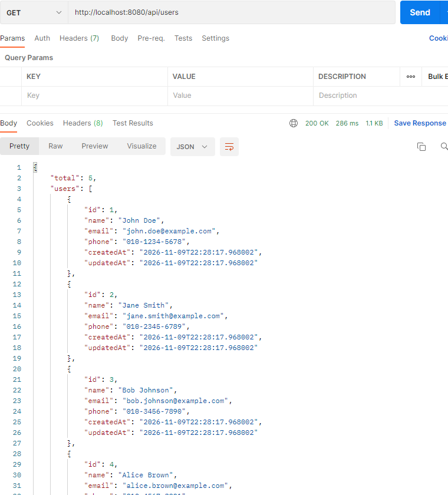
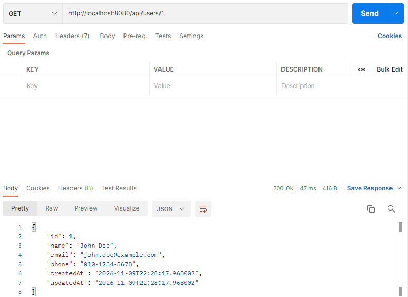
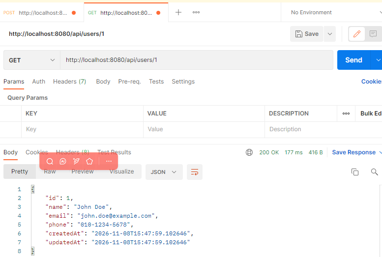
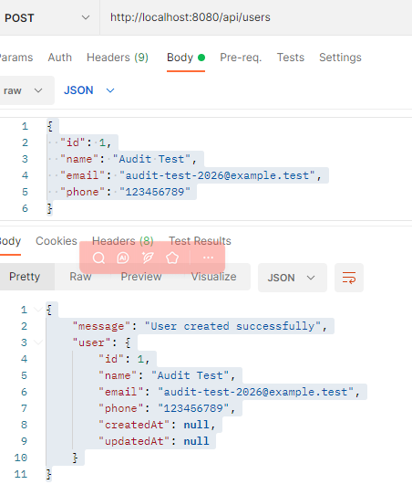
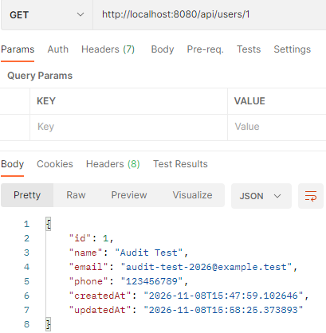
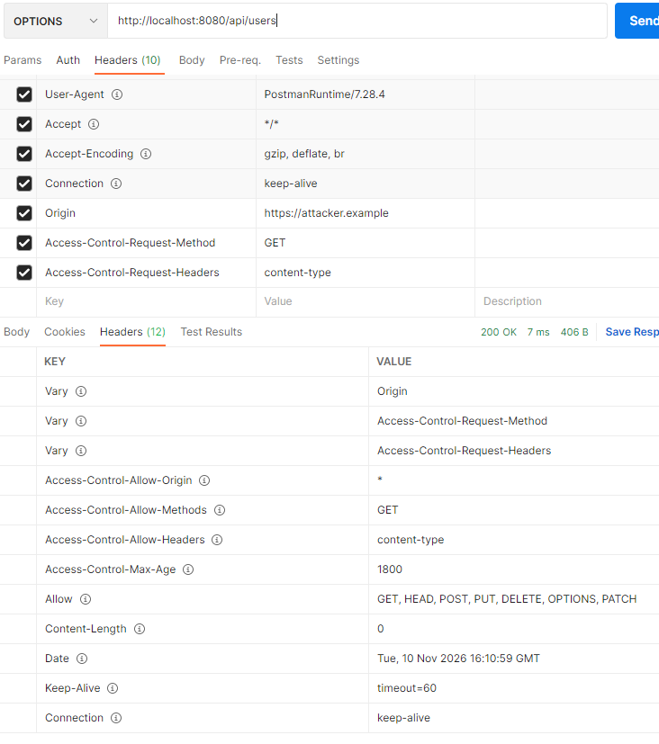
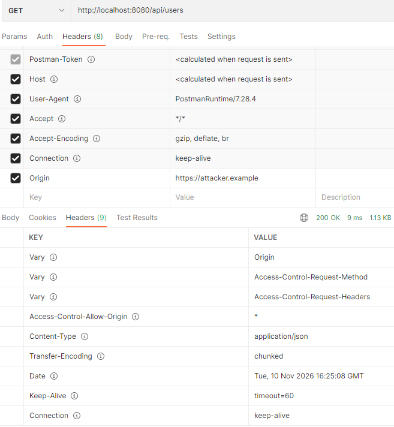
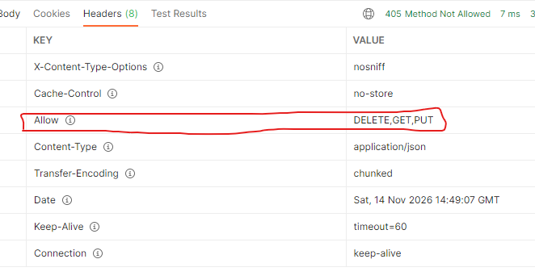

# 审计测试

## F-01：漏洞名称，用户接口缺少身份认证

- 涉及接口：`GET /api/users`
- 涉及接口：`GET /api/users/{id}`
- 代码位置：`UserController.java`
- 代码问题：Controller没有认证或授权检查。
- 影响：攻击者可以通过邮箱查询接口探测邮箱是否注册。
- 测试方式：Postman不携带 Authorization信息直接发送GET请求。
- 测试结果：

| 漏洞编号 | 测试接口              | 匿名请求结果                                                 | 结论                 |
| -------- | --------------------- | ------------------------------------------------------------ | -------------------- |
| VUL-01-1 | `GET /api/users`      | 200，返回全部用户数据 | 确认匿名读取用户列表 |
| VUL-01-2 | `GET /api/users/{id}` | 200，返回指定用户信息 | 确认匿名读取单个用户 |

- 初步结论：确认存在未认证访问问题。
- 潜在影响：用户个人信息泄露。


## F-02：创建用户接口允许客户端指定主键并修改已有记录

**问题类型：** Mass Assignment / 客户端可控属性 / 数据完整性风险

**关联 CWE：** CWE-915

**涉及文件：**

- UserDTO.java
- UserService.java
- UserController.java

**问题代码：**

```
private User convertToEntity(UserDTO userDTO) {
    User user = new User();
    user.setId(userDTO.getId());
    user.setName(userDTO.getName());
    user.setEmail(userDTO.getEmail());
    user.setPhone(userDTO.getPhone());
    return user;
}
```

**问题原因：**

创建用户接口允许客户端通过 JSON 提交 ID，Service 层将客户端提供的 ID 写入 User Entity，随后调用 JpaRepository.save()。

当客户端提交的 ID 对应数据库中已经存在的用户时，Spring Data JPA 将该实体识别为非新实体，执行 merge 操作，导致已有记录被修改。

**测试结果：**

| get 查询id=1的数据                | post 查询id=1的数据，请求成功                  | get 查询id=1的数据，数据变化                   |
| --------------------------------- | ---------------------------------------------- | ---------------------------------------------- |
|  |  |  |

**安全影响：**

在当前未发现身份认证和权限控制的项目环境下，如果接口对外开放，未认证用户可能通过创建接口修改已有用户记录，造成用户数据被篡改。

**整改建议：**

1. 创建用户使用独立新增的DTO（UserCreateRequest）。
2. 创建的DTO不允许客户端提交ID，直接不用到id。
3. 创建Entity时不调用setId()。
4. 由数据库自动生成主键。
5. 创建接口与更新接口保持独立的数据处理逻辑。

**验证状态：已动态复现。**

**整改状态：重写createUser逻辑，不将id作为传入参数。**

**复测结果：**

1. 创建请求中即使提交 id 字段，也不修改已有记录。
2. 正常创建用户时，由数据库自增长生成新ID。
3. 原有用户信息保持不变。


### F-03：更新用户接口缺少身份认证和访问控制

**问题类型：** Authentication Bypass / Broken Access Control

**涉及接口：** `PUT /api/users/{id}`

**涉及文件：** `UserController.java`、`UserService.java`

**测试方式：** Postman 不携带 Authorization 信息，直接发送 PUT 请求。

**验证状态：** 

| 测试前数据                                                   | 测试结果                                                     |
| ------------------------------------------------------------ | ------------------------------------------------------------ |
| get http://localhost:8080/api/users/1<br />{"id": 1,<br/>  "name": "John Doe",<br/>  "email": "john.doe@example.com",<br/>  "phone": "010-1234-5678",<br/>  "createdAt": "2026-11-09T22:28:17.968002",<br/>  "updatedAt": "2026-11-09T22:28:17.968002"} | 1.PUT http://localhost:8080/api/users/1<br />{"message": "User updated successfully",<br />id": 1,<br/>  "name": "Audit Test",<br/>  "email": "audit-test-2026@example.test",<br/>  "phone": "123456789"}<br />2.GET http://localhost:8080/api/users/1<br />{  "id": 1,<br/>    "name": "Audit Test",<br/>    "email": "audit-test-2026@example.test",<br/>    "phone": "123456789",<br/>    "createdAt": "2026-11-10T22:19:36.834985",<br/>    "updatedAt": "2026-11-10T22:20:31.901616"}<br />3.数据库内容id=1同步修改 |

**安全影响：** 如果匿名请求能够成功修改用户数据，攻击者可能篡改其他用户的信息，影响数据完整性。

**整改状态：** 待整改。


### F-04：删除用户接口缺少身份认证和访问控制

**问题类型：** Authentication Bypass / Broken Access Control

**涉及接口：** `DELETE /api/users/{id}`

**涉及文件：** `UserController.java`、`UserService.java`

**测试方式：** Postman 不携带 Authorization 信息，直接发送DELETE请求。

**验证状态：** 

| 测试前数据                                                   | 测试结果                                                     |
| ------------------------------------------------------------ | ------------------------------------------------------------ |
| get http://localhost:8080/api/users/1<br />{"id": 1,<br/>  "name": "John Doe",<br/>  "email": "john.doe@example.com",<br/>  "phone": "010-1234-5678",<br/>  "createdAt": "2026-11-09T22:28:17.968002",<br/>  "updatedAt": "2026-11-09T22:28:17.968002"} | 1.DELETE http://localhost:8080/api/users/1<br />{"message": "User deleted successfully","userId": 1}<br />2.GET http://localhost:8080/api/users/1<br />{"error": "Not Found",<br/>    "message": "User not found with id: 1",<br/>    "timestamp": "2026-11-10T23:32:23.5482727",<br/>    "status": 404}<br />3.数据库内容id=1同步被删除 |

**安全影响：** 如果匿名请求能够成功删除用户数据，攻击者可能篡改其他用户的信息，影响数据完整性。

**整改状态：** 待整改。


### F-05：CORS 跨域策略配置过于宽松

**问题类型：** CORS Misconfiguration

**涉及接口：** `/api/users/**`

**涉及文件：** `UserController.java`

**问题代码：**

```
@CrossOrigin(origins = "*")
```

**测试结果：**

| 测试 <br />Origin：https://attacker.example      | 发送请求及响应        | 实际结果（检查服务器返回的 CORS 响应头）                     |
| ------------------------------------------------ | --------------------- | ------------------------------------------------------------ |
| 使用 Postman 发送 OPTIONS 预检请求               |  | Access-Control-Allow-Origin: * <br />Access-Control-Allow-Methods: GET <br />Access-Control-Allow-Headers: content-type <br />Access-Control-Max-Age: 1800<br />表明服务器对来自 `https://attacker.example` 的 GET 跨域预检请求返回了允许任意来源的策略。 |
| 使用 Postman 发送携带恶意模拟 Origin 的 GET 请求 |  | Access-Control-Allow-Origin: *<br />表示浏览器可以允许来自任意 Origin 的网页 JavaScript 读取这个响应（还需要满足其他 CORS 条件） |

**安全影响：** 如果服务器允许不受信任的来源读取 API 响应，可能扩大跨域数据暴露风险。实际影响取决于接口数据、浏览器凭据策略及其他访问控制措施。

**整改状态：** 待整改。


### F-06：H2 Console 管理界面暴露及数据库弱认证风险

**问题类型：** Sensitive Administrative Interface Exposure / Weak Database Authentication

**涉及配置文件：** `application.properties`

**管理接口：** `/h2-console`

**数据库连接地址：** `jdbc:h2:mem:auditdb`

**问题配置：**

```properties
spring.datasource.username=sa
spring.datasource.password=

spring.h2.console.enabled=true
spring.h2.console.path=/h2-console
```

**静态审计结果：**

1. H2 Console 已启用。
2. 数据库使用默认用户名 `sa`。
3. 数据库密码为空。
4. H2 Console 未配置独立的远程访问参数。

**动态测试方式：**

1. 浏览器访问 `http://localhost:8080/h2-console`。
2. 使用 `sa` 用户和空密码登录。
3. 使用 `jdbc:h2:mem:auditdb` 连接数据库。内存模式。
4. 执行只读 SQL，检查数据库用户、Schema 和表结构。

**动态测试结果：**

| 测试项目            | 实际结果                                                     |
| ------------------- | ------------------------------------------------------------ |
| H2 Console 是否启用 | 可以访问                                                     |
| 数据库用户名        | SA                                                           |
| 空密码登录          | 成功                                                         |
| 当前数据库用户      | SA                                                           |
| 当前 Schema         | PUBLIC                                                       |
| 应用数据库表        | USERS                                                        |
| 其他计算机能否访问  | 在全局搜索<br />web-allow-others<br/>SPRING_H2_CONSOLE_SETTINGS_WEB_ALLOW_OTHERS<br/>spring.profiles.active<br />未发现有相关的输出，远程未发现显式开启配置 |

**安全影响：**

H2 Console 提供数据库管理能力。如果管理入口对不可信用户开放，且数据库使用空密码，攻击者可能获得数据库访问权限，导致用户数据泄露、篡改或删除。

**验证结论：**

已确认本机能够访问 H2 Console，并使用 SA 空密码连接数据库。远程不可访问。

**整改建议：**

1. 非开发环境关闭 H2 Console。
2. 数据库设置强密码，不使用空密码。
3. 限制数据库管理界面的访问范围。
4. 避免在生产环境启用 H2 Console。

**整改状态：** 待整改。


## F-07：敏感信息泄露与日志安全审计

### F-07-01：API 响应包含用户个人信息

**问题类型：** Sensitive Information Exposure / Broken Access Control

**涉及接口：**GET `/api/users`、GET `/api/users/{id}`

**涉及文件：** UserController.java、UserDTO.java、UserService.java

**测试方式：**使用 Postman 不携带 Authorization 信息，直接请求用户查询接口。

| 测试方式                              | **测试结果**                                                 |
| ------------------------------------- | ------------------------------------------------------------ |
| GET http://localhost:8080/api/users   | 匿名用户可以读取全部用户列表，返回数据包含姓名、邮箱及手机号 |
| GET http://localhost:8080/api/users/1 | 匿名用户可以根据 ID 查询指定用户，返回数据包含姓名、邮箱及手机号 |

**代码审计结果：**

UserDTO 当前包含：id、name、email、phone、createdAt、updatedAt，未发现 password、passwordHash、token 等认证凭据字段。

Controller 通过 UserService 将 Entity 转换为 UserDTO 返回，目前未发现直接返回 User Entity 的情况。

**安全影响：**

未认证用户可以获取用户姓名、邮箱和手机号等个人信息，造成未经授权的个人信息泄露。

**漏洞根因：**

主要根因是 F-01 已确认的身份认证和访问控制缺失，而不是 DTO 本身包含密码字段。

**整改建议：**

1. 对用户查询接口实施身份认证和访问控制。
2. 根据用户角色限制用户列表及单个用户信息的读取范围。
3. 遵循最小必要原则，减少不必要的个人信息返回。
4. 对敏感个人信息实施必要的访问限制或脱敏。

**整改状态：** 待整改，关联 F-01。


### F-07-02：Hibernate SQL 参数日志可能泄露用户个人信息

**问题类型：** Sensitive Information Exposure / Excessive Logging

**关联 CWE：** CWE-532

**涉及配置：** application.properties

**原始日志配置：**

```
spring.jpa.show-sql=true
logging.level.org.hibernate.SQL=DEBUG
logging.level.org.hibernate.type.descriptor.sql.BasicBinder=TRACE
```

**环境确认：**

项目使用 Hibernate ORM 6.3.1.Final。

原有 BasicBinder 日志类别没有显示实际绑定参数值。经确认，当前 Hibernate 版本对应的 JDBC 参数日志类别为：

```
org.hibernate.orm.jdbc.bind
```

**动态测试方式：**

在本地测试环境临时开启：

```
logging.level.org.hibernate.orm.jdbc.bind=TRACE
```

使用 Postman 创建虚构测试用户，观察 IntelliJ IDEA 控制台日志。

```json
{
  "name": "Log Audit Test",
  "email": "log-audit@example.test",
  "phone": "000000000"
}
```

**实际测试结果：**

日志成功输出：

```
binding parameter (2:VARCHAR) <- [log-audit@example.test]
binding parameter (3:VARCHAR) <- [Log Audit Test]
binding parameter (4:VARCHAR) <- [000000000]
```

同时还记录了创建时间和更新时间。

**结论：**

已经动态证明，在开启 Hibernate JDBC 参数绑定 TRACE 日志后，SQL 参数的实际值会进入日志输出。

但是，本次使用的是临时测试配置，尚未证明原始运行环境在默认配置下就会记录这些参数。

**安全影响：**

如果生产环境启用参数绑定 TRACE，具有日志读取权限的人员可能获得用户姓名、邮箱、手机号等个人信息。

**整改建议：**

1. 生产环境禁止开启 Hibernate JDBC 参数绑定 TRACE。
2. 避免在日志中记录密码、Token 和其他认证凭据。
3. 限制日志文件访问权限。
4. 设置合理的日志保留及清理策略。
5. 关闭不必要的 SQL 调试输出。

**整改状态：** 待整改及确认临时TRACE配置已移除。


### F-07-03：业务代码主动记录敏感信息检查

**问题类型：** Sensitive Information Logging

**检查方式：**

使用 IntelliJ IDEA 全项目搜索：System.out.println、System.err.println、printStackTrace、log.info、log.warn、log.error、log.debug、logger.info、logger.warn、logger.error、LoggerFactory、org.slf4j.Logger、@Slf4j、@Log4j2、java.util.logging

**测试结果：**

未发现业务代码主动记录用户密码、Token 或个人信息的日志调用。

**结论：**

当前项目源码中未发现明显的业务层敏感信息日志记录行为，该结论不代表第三方依赖或运行环境产生的日志不存在敏感信息。

**验证状态：** 已完成源码搜索。

**审计结论：** 暂未发现。


### F-07-04：异常响应暴露内部信息检查

**涉及文件：** GlobalExceptionHandler.java

**检查内容：**

1. 用户不存在异常。
2. 参数校验异常。
3. 通用 Exception 异常。

**测试一：查询不存在的用户 ID**

GET http://localhost:8080/api/users/7

```json
实际响应：
{
  "error": "Not Found",
  "message": "User not found with id: 7",
  "timestamp": "2026-11-11T19:55:23.8404758",
  "status": 404
}
```

**测试二：查询不存在的邮箱**

GET http://localhost:8080/api/users/email/notexist-audit@example.test

```json
实际响应：
{
  "error": "Not Found",
  "message": "User not found with email: notexist-audit@example.test",
  "timestamp": "2026-11-11T19:56:12.7134105",
  "status": 404
}
```

**测试三：提交非法参数**

PUT http://localhost:8080/api/users/1

```json
实际响应：
{
    "error": "Validation Failed",
    "errors": {
        "name": "Name is required"
    },
    "timestamp": "2026-11-11T22:25:56.2018304",
    "status": 400
}
```

**代码审计结果：**

用户不存在异常处理使用：

```java
ex.getMessage()
```

将异常消息直接返回客户端。

通用异常处理使用固定错误消息：

```
An unexpected error occurred
```

没有直接返回完整异常堆栈或异常原文。

**测试结论：**

1. 未发现异常堆栈直接返回客户端。
2. 未发现 SQL 语句直接暴露。
3. 未发现服务器本地路径直接暴露。
4. 用户不存在异常会回显请求中的 ID 或邮箱。
5. 参数校验异常仅返回字段校验信息。

**安全影响：**

错误消息回显可能泄露用户标识或邮箱输入信息。结合邮箱查询接口，存在辅助邮箱枚举的风险，目前尚未完成已存在邮箱与不存在邮箱的完整对照测试，因此不将邮箱枚举记为已完全动态确认的独立漏洞。

**整改建议：**

1. 避免将内部异常原文直接返回客户端。
2. 对外使用统一、适当的错误消息。
3. 服务端保留必要的异常日志，避免记录敏感信息。
4. 对用户查询接口实施身份认证与访问控制。

**验证状态：** 已完成异常响应动态检查。

**审计结论：** 未发现明显的高风险异常信息泄露。


### F-07-05：DTO 参数校验有效性检查

**涉及文件：**UserDTO.java、UserCreateRequest.java、UserController.java、GlobalExceptionHandler.java

**测试接口：**

#### POST `/api/users`

| 测试项目       | 输入情况                 | 实际状态码 | 结果                                                         |
| -------------- | ------------------------ | ---------- | ------------------------------------------------------------ |
| 姓名           | 1 个字符                 | 400        | {   "error": "Validation Failed",<br/>    "errors": {<br/>        "name": "Name is required"<br/>    },<br/>    "timestamp": "2026-11-11T21:02:22.1227902",<br/>    "status": 400 } |
| 邮箱           | 非法邮箱格式             | 400        | {   "error": "Validation Failed",<br/>    "errors": {<br/>        "email": "Email should be valid"<br/>    },<br/>    "timestamp": "2026-11-11T21:02:37.6559977",<br/>    "status": 400 } |
| 手机号         | 超过 15 个字符           | 400        | {   "error": "Validation Failed",<br/>    "errors": {<br/>        "phone": "Phone number cannot exceed 15 characters"<br/>    },<br/>    "timestamp": "2026-11-11T21:02:58.1572625",<br/>    "status": 400 } |
| 多字段联合错误 | 姓名、邮箱、手机号均非法 | 400        | { "error": "Validation Failed",<br/>    "errors": {<br/>        "phone": "个数必须在0和15之间",<br/>        "name": "不能为空",<br/>        "email": "不是一个合法的电子邮件地址"<br/>    },<br/>    "timestamp": "2026-11-11T20:53:24.1443971",<br/>    "status": 400 } |

#### PUT `/api/users/{id}`

| 测试项目         | 输入情况      | 实际状态码 | 数据库变化 | 结果                                                         |
| ---------------- | ------------- | ---------- | ---------- | ------------------------------------------------------------ |
| 姓名为空         | 违反 NotBlank | 400        | 无变化     | {  "error": "Validation Failed",<br/>    "errors": {<br/>        "name": "Name is required"<br/>    },<br/>    "timestamp": "2026-11-11T21:02:22.1227902",<br/>    "status": 400 } |
| 邮箱格式错误     | 违反 Email    | 400        | 无变化     | {   "error": "Validation Failed",<br/>    "errors": {<br/>        "email": "Email should be valid"<br/>    },<br/>    "timestamp": "2026-11-11T21:02:37.6559977",<br/>    "status": 400 } |
| 手机号超过 15 位 | 违反 Size     | 400        | 无变化     | {  "error": "Validation Failed",<br/>    "errors": {<br/>        "phone": "Phone number cannot exceed 15 characters"<br/>    },<br/>    "timestamp": "2026-11-11T21:02:58.1572625",<br/>    "status": 400 } |

#### 姓名长度边界测试，PUT `/api/users/{id}`

UserDTO 中姓名校验规则：

```java
@Size(min = 2, max = 100)
```

| 测试编号 | 姓名长度 | 实际结果 | 数据库变化 | 结果                                                         |
| -------- | -------- | -------- | ---------- | ------------------------------------------------------------ |
| BOUND-01 | 1        | HTTP 400 | 无变化     | {   "error": "Validation Failed",<br/>    "errors": {<br/>        "name": "Name must be between 2 and 100 characters"<br/>    },<br/>    "timestamp": "2026-11-11T21:06:01.5737046",<br/>    "status": 400 } |
| BOUND-02 | 2        | HTTP 200 | 更新成功   | {   "message": "User updated successfully",<br/>    "user": {<br/>        "id": 1,<br/>        "name": "AB",<br/>        "email": "audit-test-2026@example.test",<br/>        "phone": "123456789",<br/>        "createdAt": "2026-11-11T19:23:11.724232",<br/>        "updatedAt": "2026-11-11T19:23:11.724232"<br/>    }} |
| BOUND-03 | 100      | HTTP 200 | 更新成功   | {   "message": "User updated successfully",<br/>    "user": {<br/>        "id": 1,<br/>        "name": "qwertqwertqwertqwertqwertqwertqwertqwertqwertqwertqwertqwertqwertqwertqwertqwertqwertqwertqwertqwert",<br/>        "email": "audit-test-2026@example.test",<br/>        "phone": "123456789",<br/>        "createdAt": "2026-11-11T19:23:11.724232",<br/>        "updatedAt": "2026-11-11T21:06:21.266002"<br/>    }} |
| BOUND-04 | 101      | HTTP 400 | 无变化     | {   "error": "Validation Failed",<br/>    "errors": {<br/>        "name": "Name must be between 2 and 100 characters"<br/>    },<br/>    "timestamp": "2026-11-11T21:08:59.1405845",<br/>    "status": 400 } |

**测试结论：**

POST 和 PUT 接口的基本参数校验均正常工作，姓名长度的最小值和最大值边界均符合预期，非法 PUT 请求没有改变数据库记录。

**验证状态：** 已动态验证。

**审计结论：** 基础校验通过。


### F-07-06：手机号格式校验不足

**问题类型：** Insufficient Input Validation

**涉及文件：**UserDTO.java、UserCreateRequest.java

**原始校验规则：**

```java
@Size(max = 15)@NotBlank(message = "Phone number is required")
private String phone;
```

**动态测试结果：**

| 测试输入 | 实际状态码 | 实际结果 | 结果                                                         |
| -------- | ---------- | -------- | ------------------------------------------------------------ |
| 空手机号 | 400        | 正确拒绝 | {   "error": "Validation Failed",<br/>    "errors": {<br/>        "phone": "Phone number is required"<br/>    },<br/>    "timestamp": "2026-11-11T21:13:50.9164123",<br/>    "status": 400 } |
| 11aa     | 200        | 更新成功 | {<br/>    "message": "User updated successfully",<br/>    "user": {<br/>        "id": 1,<br/>        "name": "11t",<br/>        "email": "audit-test-2026@example.test",<br/>        "phone": "11aa",<br/>        "createdAt": "2026-11-11T21:13:37.416126",<br/>        "updatedAt": "2026-11-11T21:13:37.416126"<br/>    }<br/>}数据库数据修改<br/> |
| 068+123  | 200        | 更新成功 | {   "message": "User updated successfully",<br/>    "user": {<br/>        "id": 1,<br/>        "name": "11t",<br/>        "email": "audit-test-2026@example.test",<br/>        "phone": "068+123",<br/>        "createdAt": "2026-11-11T21:13:37.416126",<br/>        "updatedAt": "2026-11-11T21:14:31.062485"<br/>    } } |

**问题分析：**

`@NotBlank` 只能检查字段是否为空，`@Size(max = 15)` 只能限制字符串长度，两者均不能保证输入值为合法的中国大陆手机号码。

**当前业务要求：**

本项目只允许中国大陆手机号码，不支持国际号码。

预期校验标准：

1. 必须填写。
2. 仅允许数字。
3. 长度必须为 11 位。
4. 必须符合中国大陆手机号码的基本号码格式。
5. 不允许字母、空格、`+` 等其他字符。
6. POST 和 PUT 两个接口采用一致的校验规则。

**测试结论：**

目前已经动态证明非法手机号格式可以进入数据库，该问题属于输入验证不足，应单独纳入后续整改和回归测试。

**验证状态：** 已动态复现。

**整改状态：** 待整改。


## F-08：中国大陆手机号输入验证不足及整改报告

### 问题描述：

原有手机号校验主要依靠以下方式，无法验证手机号是否符合中国大陆号码格式。

```java
@Size(max = 15)
@NotBlank
private String phone;
```

动态测试发现，以下非法输入能够通过更新接口：`11aa`、`068+123`，说明原有校验规则无法有效限制手机号格式，可能导致不符合业务要求的数据进入数据库。

### 整改目标：

本项目统一采用中国大陆手机号码格式，不支持国际号码。

手机号校验要求：

1. 手机号必填。
2. 必须为 11 位。
3. 只能包含数字。
4. 第一位必须为 1。
5. 第二位必须为 3～9。
6. 不允许空格、字母及其他特殊字符。
7. 不允许使用 `+86` 国际区号。
8. POST 和 PUT 使用完全一致的校验规则。

统一正则表达式：

```java
^1[3-9][0-9]{9}$
```

### 整改方案：

分别修改 UserCreateRequest.java 和 UserDTO.java。

统一使用：

```java
@NotBlank(message = "请输入手机号")
@Pattern(
    regexp = "^1[3-9][0-9]{9}$"
    message = "请输入有效的11位中国大陆手机号码，13-19开头"
)
private String phone;
```

并导入：

```
import jakarta.validation.constraints.NotBlank;
import jakarta.validation.constraints.Pattern;
```

删除原有手机号字段的：

```
@Size(max = 15)
```

两个DTO使用相同的校验规则，保证创建和更新接口的行为一致。

### 回归测试结果：

### POST 创建接口测试

**测试接口：** `POST /api/users`，使用 UserCreateRequest 接收请求参数。

| 测试内容   | 测试输入                 | 结果     | 实际结论                                                     |
| ---------- | ------------------------ | -------- | ------------------------------------------------------------ |
| 合法手机号 | 13812345678，19900000000 | HTTP 201 | {   "message": "User created successfully",<br/>    "user": {<br/>        "id": 6,<br/>        "name": "hh",<br/>        "email": "invalid-email@qq.com",<br/>        "phone": "13509609458",<br/>        "createdAt": "2026-11-11T23:43:54.2980534",<br/>        "updatedAt": "2026-11-11T23:43:54.2980534"<br/>    } } |
| 空字符串   | `""`                     | HTTP 400 | {   "error": "Validation Failed",<br/>    "errors": {<br/>        "phone": "请输入有效的11位中国大陆手机号码，13-19开头"<br/>    },<br/>    "timestamp": "2026-11-12T01:15:05.9424103",<br/>    "status": 400} |
| null       | `null`                   | HTTP 400 | 同上                                                         |
| 纯空格     | `"   "`                  | HTTP 400 | 同上                                                         |
| 包含字母   | `11aa`                   | HTTP 400 | 同上                                                         |
| 特殊字符   | `068+123`                | HTTP 400 | 同上                                                         |
| 国际区号   | `+8613812345678`         | HTTP 400 | 同上                                                         |
| 长度不足   | `1381234567`             | HTTP 400 | 同上                                                         |
| 长度超出   | `138123456789`           | HTTP 400 | 同上                                                         |
| 不合法号段 | `12812345678`            | HTTP 400 | 同上                                                         |
| 包含空格   | `138 1234 5678`          | HTTP 400 | 同上                                                         |

**数据库验证：**

非法 POST 请求均未产生新增用户记录；合法 POST 请求能够正常创建用户，数据库保存的手机号符合要求。

### PUT 更新接口测试

**测试接口：** `PUT /api/users/{id}`，使用 UserDTO 接收请求参数。

| 测试内容   | 测试输入                 | 结果     | 实际结论                                                     |
| ---------- | ------------------------ | -------- | ------------------------------------------------------------ |
| 合法手机号 | 13812345678、19900000000 | HTTP 200 | {   "message": "User updated successfully",<br/>    "user": {<br/>        "id": 1,<br/>        "name": "黄晖",<br/>        "email": "黄晖@example.6test",<br/>        "phone": "13577555557",<br/>        "createdAt": "2026-11-12T01:14:28.314083",<br/>        "updatedAt": "2026-11-12T01:14:28.314083"<br/>    } } |
| 空字符串   | `""`                     | HTTP 400 | {  "error": "Validation Failed",<br/>    "errors": {<br/>        "phone": "请输入有效的11位中国大陆手机号码，13-19开头"<br/>    },<br/>    "timestamp": "2026-11-12T01:17:05.4592862",<br/>    "status": 400 } |
| null       | `null`                   | HTTP 400 | 同上                                                         |
| 纯空格     | `"   "`                  | HTTP 400 | 同上                                                         |
| 包含字母   | `11aa`                   | HTTP 400 | 同上                                                         |
| 特殊字符   | `068+123`                | HTTP 400 | 同上                                                         |
| 国际区号   | `+8613812345678`         | HTTP 400 | 同上                                                         |
| 长度不足   | `1381234567`             | HTTP 400 | 同上                                                         |
| 长度超出   | `138123456789`           | HTTP 400 | 同上                                                         |
| 不合法号段 | `12812345678`            | HTTP 400 | 同上                                                         |
| 包含空格   | `138 1234 5678`          | HTTP 400 | 同上                                                         |

**数据库验证：**

  非法 PUT 请求未修改原有用户记录；合法 PUT 请求能够正常更新用户信息。

### **最终结论：F-08 整改通过。**

### **后续建议：** 

保持两个 DTO 的手机号校验规则一致。后续增加用户创建、更新接口时，继续执行相同的输入验证要求。


## F-09：重复邮箱触发数据库唯一约束异常，但全局异常处理不完善。

### 问题基本信息

- **问题类型：** Improper Error Handling / Database Constraint Handling
- **涉及接口：** POST `/api/users`
- **涉及文件：** User.java、UserRepository.java、UserService.java、GlobalExceptionHandler.java

### 问题描述：

重复使用相同邮箱提交 POST 注册请求时，数据库因邮箱唯一约束拒绝插入，但全局异常处理器将该异常作为普通内部异常处理，返回 HTTP 500。

实际响应

```json
{ "error": "Internal Server Error",   
  "message": "An unexpected error occurred",   
  "timestamp": "2026-11-12T01:03:12.2960168",   
  "status": 500 } 
```

### 定位原因：

因为user.java中邮箱字段设置了唯一约束，数据库正确拒绝了重复邮箱，但应用没有对重复邮箱进行提前检查，也没有为相关异常提供专门的处理逻辑。

```java
@Column(nullable = false, unique = true)
private String email;
```

### 整改目标：

1.重复邮箱提前检查

2.返回 HTTP 409

3.保留数据库唯一约束

4.不向客户端暴露数据库内部异常信息

5.确认重复请求不会产生新的数据库记录。

### 修改代码：

1.新建一个EmailAlreadyExistsException异常类

```java
public class EmailAlreadyExistsException extends RuntimeException {
    public EmailAlreadyExistsException(String message) {
        super(message);
    }
}
```

2.在create数据时先校验email是否存在

```java
if (userRepository.existsByEmail(request.getEmail())) {
    throw new EmailAlreadyExistsException("邮箱已注册");
}
```

3.在GlobalExceptionHandler.java中统一管理异常类返回

```java
@ExceptionHandler(EmailAlreadyExistsException.class)
public ResponseEntity<Map<String, Object>> handleEmailAlreadyExists(
        EmailAlreadyExistsException ex) {
    Map<String, Object> errorResponse = new HashMap<>();
    errorResponse.put("timestamp", LocalDateTime.now());
    errorResponse.put("status", HttpStatus.CONFLICT.value());
    errorResponse.put("error", "Conflict");
    errorResponse.put("message", ex.getMessage());
    return new ResponseEntity<>(
            errorResponse,
            HttpStatus.CONFLICT
    );
}
```

### 测试：

POST http://localhost:8080/api/users，再次创建同一个邮箱的信息时返回

```json
{ "error": "Conflict",
    "message": "邮箱已注册",
    "timestamp": "2026-11-12T01:35:05.5159944",
    "status": 409
}
```

数据库数据没有新增。

### 最终结论：F-09 的主要整改已经完成；并发冲突处理作为后续额外的健壮性整改意见。


## F-10：更新接口字段边界与搜索接口输入安全审计

### 基本信息

**审计模块：** 用户更新接口、用户搜索接口

**涉及文件：**UserController.java、UserService.java、UserRepository.java、UserDTO.java、UserCreateRequest.java、User.java

**审计方式：** 静态代码审查、动态请求测试、数据库记录核对

### Email邮箱格式及长度边界测试

#### 1.1原始代码检查

原 DTO 校验规则：

```java
@NotBlank(message = "Email is required")
@Email(message = "Email should be valid")
private String email;
```

数据库查询结果：

```sql
EMAIL
CHARACTER VARYING(255)
```

发现 DTO 原先没有明确的邮箱最大长度限制，而数据库字段最大长度为 255。

#### 1.2 整改内容

在 UserCreateRequest.java 和 UserDTO.java 中统一增加：

```
@Size(max = 255, message = "邮箱长度不能超过255个字符")
```

确保创建和更新接口采用相同的邮箱长度限制。

#### 1.3 动态测试

使用 PUT 更新接口测试：

| 测试内容     | 输入                                                         | 实际结果                                                     |
| ------------ | ------------------------------------------------------------ | ------------------------------------------------------------ |
| 空字符串     | ""                                                           | {<br/>    "error": "Validation Failed",<br/>    "errors": {<br/>        "email": "Email is required"<br/>    },<br/>    "timestamp": "2026-11-12T14:34:49.7673018",<br/>    "status": 400<br/>} |
| null         | null                                                         | {<br/>    "error": "Validation Failed",<br/>    "errors": {<br/>        "email": "Email should be valid"<br/>    },<br/>    "timestamp": "2026-11-12T14:35:04.0671388",<br/>    "status": 400<br/>} |
| 空格         | "   "                                                        | 同上                                                         |
| 非法邮箱     | invalid-email                                                | 同上                                                         |
| 缺少域名     | user@                                                        | 同上                                                         |
| 缺少邮箱名称 | @example.test                                                | 同上                                                         |
| 双 @ 符号    | user@@example.test                                           | 同上                                                         |
| 包含空格     | user [name@example.test](mailto:name@example.test)           | 同上                                                         |
| 合法邮箱     | [f10-valid@example.test](mailto:f10-valid@example.test)（数据库不重复的邮箱） | HTTP 200，更新成功                                           |
| 合法邮箱     | [f101-valid@example.test](mailto:f10-valid@example.test)（数据库重复的邮箱） | {<br/>    "error": "Conflict",<br/>    "message": "邮箱已注册",<br/>    "timestamp": "2026-11-12T14:37:30.9847093",<br/>    "status": 409<br/>} |

#### 1.4 邮箱长度边界

| 测试编号 | 邮箱长度 | 实际结果                                                     |
| -------- | -------- | ------------------------------------------------------------ |
| EMAIL-10 | 255 字符 | HTTP 200，成功写入                                           |
| EMAIL-11 | 256 字符 | {<br/>    "error": "Validation Failed",<br/>    "errors": {<br/>        "email": "邮箱长度不能超过255个字符"<br/>    },<br/>    "timestamp": "2026-11-12T14:48:58.538081",<br/>    "status": 400<br/>} |

POST 和 PUT 两个接口均完成了对应的 255/256 字符测试，结果符合预期。

#### 1.5 测试结论

邮箱格式校验和最大长度限制正常，255 字符可以通过，256 字符被拒绝。

**状态：测试通过。**

### 2. Name 姓名字段边界与特殊字符测试

#### 2.1 原始校验规则

```
@NotBlank
@Size(min = 2, max = 100)
private String name;
```

#### 2.2 POST 动态测试

| 测试编号 | 姓名输入                  | 实际结果                                                     |
| -------- | ------------------------- | ------------------------------------------------------------ |
| NAME-01  | 两个空格                  | {<br/>    "error": "Validation Failed",<br/>    "errors": {<br/>        "name": "不能为空"<br/>    },<br/>    "timestamp": "2026-11-12T14:59:22.7327538",<br/>    "status": 400<br/>} |
| NAME-02  | 张三                      | 创建成功                                                     |
| NAME-03  | O'Connor                  | 创建成功                                                     |
| NAME-04  | 李-明                     | 创建成功                                                     |
| NAME-05  | <script>alert(1)</script> | 创建成功                                                     |
| NAME-06  | ' OR '1'='1               | 创建成功                                                     |

实际测试创建了以下测试记录：

- ID=8：张三
- ID=9：O'Connor
- ID=10：李-明
- ID=11：<script>alert(1)</script>
- ID=12：' OR '1'='1

#### 2.3 PUT 动态测试

| 测试编号 | 姓名输入                  | 实际结果 |
| -------- | ------------------------- | -------- |
| 1        | O'Connor                  | 更新成功 |
| 2        | <script>alert(1)</script> | 更新成功 |
| 3        | ' OR '1'='1               | 更新成功 |

#### 2.4 安全分析

**HTML/XSS 输入：**

能够保存 `<script>alert(1)</script>`，仅证明服务端允许该字符串进入数据库。

当前没有验证浏览器前端是否使用不安全的 HTML 渲染方式，因此不能认定已经存在存储型 XSS。

**SQL 注入特征字符串：**

能够保存 `' OR '1'='1`，不代表数据库执行了 SQL 代码。

后续结合搜索接口 SQL 注入测试，未发现该字符串被执行为 SQL 条件的证据。

**中文、英文姓名及连字符：**

测试均正常，未发现不合理拒绝。

#### 2.5 测试结论

当前姓名字段长度及非空校验正常。

特殊字符能够作为普通字符串保存，没有发现已确认的 XSS 或 SQL 注入漏洞。

不过，前端输出编码仍需结合实际页面单独审计。

**状态：未发现明确漏洞。**

### 3. PARAM-01：客户端篡改 JSON ID 测试

#### 3.1 测试目的

验证客户端提交的 JSON ID 是否会影响 PUT 接口实际更新的目标记录。

#### 3.2 测试方式

```
发送 PUT /api/users/20
```

JSON 请求体提交：

```
{
  "id": 21,
  "name": "F10 ID Tampered",
  "email": "f10-id-a@example.test",
  "phone": "13812345678"
}
```

其中：URL ID 为 20；JSON ID 为 21。

#### 3.3 实际测试结果

测试发现：

1. 修改的是 URL 中 ID=20 对应的记录。
2. JSON 中的 ID=21 不影响更新目标。
3. ID=21 对应的记录没有因为 JSON ID 被修改。

#### 3.4 原因分析

Controller 使用：

```
@PathVariable Long id
```

将 URL 中的 ID 传给 Service。

Service 使用：

```
User existingUser = userRepository.findById(id)
        .orElseThrow(...);
```

根据 URL ID 查询实体。

更新时只复制：

```
existingUser.setName(userDTO.getName());
existingUser.setEmail(userDTO.getEmail());
existingUser.setPhone(userDTO.getPhone());
```

没有调用 `userDTO.getId()` 修改实体主键。

#### 3.5 测试结论

未发现客户端通过 JSON 中的 ID 改变 PUT 实际更新目标的问题。

但这不代表 URL ID 的对象级访问控制已经安全。F-03 已经确认更新接口缺少身份认证和访问控制，该问题仍需独立整改。

建议后续使用独立的 UserUpdateRequest DTO，不再包含 id 字段。

**状态：未发现该项篡改问题。**

### 4. PARAM-02：客户端篡改时间字段测试

#### 4.1 测试目的

确认客户端能否通过 JSON 修改用户的创建时间和更新时间。

DTO 包含：

```java
private LocalDateTime createdAt;
private LocalDateTime updatedAt;
```

#### 4.2 测试方式

发送 PUT 请求，提交：

```json
{
  "id": 20,
  "name": "F10 ID Tampered",
  "email": "f10-id-a@example.test",
  "phone": "13812345678",
  "createdAt": "2000-01-01T00:00:00",
  "updatedAt": "2001-01-01T00:00:00"
}
```

#### 4.3 实际结果

```json
{
  "id": 20,
  "name": "F10 ID Tampered",
  "email": "f10-id-a@example.test",
  "phone": "13812345678",
  "createdAt": "2026-11-12T20:00:50",
  "updatedAt": "2026-11-12T20:10:50"
}
```

未因为修改用户的创建时间和更新时间而修改数据库的创建时间和更新时间。

#### 4.4 原因分析

Entity 对 createdAt 使用：

```java
@Column(
    name = "created_at",
    nullable = false,
    updatable = false
)
private LocalDateTime createdAt;
```

实体生命周期事件：

```java
@PrePersist
protected void onCreate() {
    createdAt = LocalDateTime.now();
    updatedAt = LocalDateTime.now();
}
@PreUpdate
protected void onUpdate() {
    updatedAt = LocalDateTime.now();
}
```

因此：

- createdAt 由服务端创建时生成，普通更新不允许修改。
- updatedAt 由服务端更新时自动生成。

#### 4.5 测试结论

未发现通过 JSON 提交时间字段篡改数据库时间的问题。建议后续将创建和更新请求 DTO 与响应 DTO 分离，避免客户端提交不需要的系统管理字段。

**状态：测试通过。**

### 5. SEARCH-01：搜索接口 SQL 注入验证

#### 5.1 原始 Repository 代码

```java
@Query("SELECT u FROM User u WHERE u.name LIKE %:name%")
List<User> findByNameContaining(@Param("name") String name);
```

代码使用 JPQL 参数绑定，没有发现直接拼接用户输入构造 SQL 的行为。

#### 5.2 测试

| 测试 | 输入条件                       | 结果                                                         | 结论                                                         |
| ---- | ------------------------------ | ------------------------------------------------------------ | ------------------------------------------------------------ |
| 1    | ' OR '1'='1                    | {<br/>    "total": 1,<br/>    "searchTerm": "' OR '1'='1",<br/>    "users": [<br/>        {<br/>            "id": 9,<br/>            "name": "' OR '1'='1",<br/>            "email": "19958@qq.com",<br/>            "phone": "14345678911",<br/>            "createdAt": "2026-11-12T15:15:07.533445",<br/>            "updatedAt": "2026-11-12T15:40:54.767355"<br/>        },<br/>      ]<br/>} | 返回一条记录。经核查，这两条记录是之前 NAME 特殊字符测试创建的真实用户，姓名本身就是该字符串。因此，这次返回结果不能证明 SQL 注入成功。 |
| 2    | F10-SQLI-PROBE-' OR '1'='1' -- | {<br/>  "total": 0,<br/>  "searchTerm": "F10-SQLI-PROBE-' OR '1'='1' --",<br/>  "users": []<br/>} | 搜索接口将测试字符串作为普通查询参数处理，未发现 SQL 注入执行的证据。该结论仅覆盖目前审计的用户姓名搜索接口，不能代表整个项目所有 SQL 查询均不存在注入风险。 |

**状态：测试通过，未发现 SQL 注入。**

### 6. SEARCH-02 / SEARCH-03：LIKE 通配符未转义问题

#### 6.1 原始问题

原查询：

```java
@Query("SELECT u FROM User u WHERE u.name LIKE %:name%")
List<User> findByNameContaining(@Param("name") String name);
```

客户端输入 `%` 和 `_` 时，数据库将其识别为 LIKE 通配符。

#### 6.2 整改前测试

| 测试输入                                          | 实际结果     |
| ------------------------------------------------- | ------------ |
| GET http://localhost:8080/api/users/search?name=% | 返回全部用户 |
| GET http://localhost:8080/api/users/search?name=_ | 返回全部用户 |

原查询使用参数绑定，因此该问题属于 LIKE 通配符未转义，并非已经证明的 SQL 注入。

#### 6.3 Repository 整改

修改后的代码：

```JAVA
@Query("SELECT u FROM User u WHERE u.name LIKE :pattern ESCAPE '!'")
List<User> searchByNamePattern(@Param("pattern") String pattern);
```

`ESCAPE '!'`告诉数据库：! 后面的 % 或 _ 是普通字符，而不是通配符；使用 `!` 作为 LIKE 转义字符。

#### 6.4 Service 整改

修改后的搜索方法：

```JAVA
@Transactional(readOnly = true)
public List<UserDTO> searchUsersByName(String name) {
    if (name == null || name.isBlank()) {
        return List.of();
    }
    String escapedName = escapeLikeWildcards(name);
    String pattern = "%" + escapedName + "%";
    return userRepository.searchByNamePattern(pattern)
            .stream()
            .map(this::convertToDTO)
            .collect(Collectors.toList());
}
```

特殊字符转义方法：

```JAVA
private String escapeLikeWildcards(String value) {
    return value
            .replace("!", "!!")
            .replace("%", "!%")
            .replace("_", "!_");
}
```

#### 6.5 转义原理

使用 `!` 作为转义字符：

| 原始字符 | 转义后 | 数据库处理方式 |
| -------- | ------ | -------------- |
| `%`      | `!%`   | 匹配实际百分号 |
| `_`      | `!_`   | 匹配实际下划线 |
| `!`      | `!!`   | 匹配实际感叹号 |

Service 处理后，再在搜索内容前后添加 `%`，保留普通模糊搜索能力。

#### 6.6 整改后回归测试

| 测试编号 | 搜索输入                                            | 实际结果                        | 状态 |
| -------- | --------------------------------------------------- | ------------------------------- | ---- |
| LIKE-01  | GET http://localhost:8080/api/users/search?name=%   | 只返回姓名中实际包含 `%` 的记录 | 通过 |
| LIKE-02  | GET http://localhost:8080/api/users/search?name=＿  | 只返回姓名中实际包含 `_` 的记录 | 通过 |
| LIKE-03  | GET http://localhost:8080/api/users/search?name=F10 | 正常模糊搜索                    | 通过 |
| LIKE-04  | GET http://localhost:8080/api/users/search?name=！  | 按普通字符匹配                  | 通过 |

#### 6.7 URL 编码问题说明

曾直接访问：

```
http://localhost:8080/api/users/search?name=%
```

出现 HTTP 500。原因需要与 LIKE 转义问题区分：URL 中的 `%` 是特殊字符，应当进行 URL 编码。

正确请求编码形式：

```
http://localhost:8080/api/users/search?name=%25
```

在 Postman Params 中填写原始 `%`，由 Postman 自动编码。

经过正确编码的 `%` 请求可以正常返回包含实际百分号的记录。

直接使用未编码 `%` 出现的 HTTP 500 属于独立的请求解析异常，未纳入本次 LIKE 通配符整改通过范围。

#### 6.8 测试结论

LIKE 特殊字符转义整改有效。普通姓名模糊搜索功能保留，特殊字符不再作为通配符扩大搜索范围。

**状态：已整改，回归测试通过。**

### 7. 综合安全分析

本次审计主要涉及三个方面：

#### 7.1 输入边界

邮箱长度、姓名长度、特殊字符等测试，未发现明显的校验绕过问题。

#### 7.2 对象与系统字段

JSON ID 和时间字段篡改测试均符合预期。URL ID 仍然需要结合 F-03 的身份认证和对象级授权问题进行处理。

### 7.3 搜索接口

JPQL 参数绑定未发现 SQL 注入执行的证据。

LIKE 通配符未转义问题已经完成整改。

但需要注意，搜索接口仍然涉及用户个人信息返回，匿名访问风险仍由 F-01 跟进处理。

**F-10 总体状态：本轮测试项目已完成，已确认的 LIKE 通配符问题已修复。**

**保留事项：**

1. 搜索接口匿名访问及用户信息泄露仍需结合 F-01 整改。
2. 搜索接口分页和最大返回数量限制尚未审计。
3. 未编码 `%` 请求导致 HTTP 500 的异常处理问题尚未单独解决。
4. HTML 字符串是否存在存储型 XSS，尚未完成前端输出场景验证。


## F-11：用户搜索接口分页与批量数据泄露审计

### 1. 基本信息

- **审计模块：** 用户列表及姓名搜索接口
- **问题类型：** Missing Pagination / Excessive Data Exposure / Broken Access Control
- **涉及接口：**GET `/api/users`、GET `/api/users/search`
- **涉及文件：**UserController.java、UserService.java、UserRepository.java
- **测试方式：** 静态代码审查、Postman 动态验证、数据库查询验证

### 2. 用户列表接口分页检查

#### 2.1 原始 Controller 代码

```java
@GetMapping
public ResponseEntity<Map<String, Object>> getAllUsers() {
    List<UserDTO> users = userService.getAllUsers();
    Map<String, Object> response = new HashMap<>();
    response.put("users", users);
    response.put("total", users.size());
    return ResponseEntity.ok(response);
}
```

**代码分析：**Controller 直接接收 Service 返回的完整 `List<UserDTO>`，没有使用分页参数，也没有限制单次返回的数据数量。

#### 2.2 原始 Service 代码

```java
@Transactional(readOnly = true)
public List<UserDTO> getAllUsers() {
    return userRepository.findAllOrderByCreatedAtDesc()
            .stream()
            .map(this::convertToDTO)
            .collect(Collectors.toList());
}
```

**代码分析：**Service 调用 Repository 获取全部用户，再将所有 Entity 转换为 DTO。

当前逻辑没有使用：Pageable、PageRequest、Page、Slice，因此没有看到分页查询机制。

#### 2.3 原始 Repository 代码

```java
@Query("SELECT u FROM User u ORDER BY u.createdAt DESC")
List<User> findAllOrderByCreatedAtDesc();
```

Repository 直接返回 List，没有接收 Pageable 参数。这意味着数据库查询没有通过分页机制限制返回记录数量。

#### 2.4 动态测试

| 编号    | 检查项目                                                     | 测试结果                            |
| ------- | ------------------------------------------------------------ | ----------------------------------- |
| F-11-01 | 用户列表接口分页检查  GET http://localhost:8080/api/users    | 一次性返回全部用户                  |
| F-11-02 | 用户列表分页参数检查  GET http://localhost:8080/api/users?page=0&size=5 | page、size 参数未生效               |
| F-11-03 | 不同页码数据检查  <br />GET http://localhost:8080/api/users?page=0&size=2<br />GET http://localhost:8080/api/users?page=1&size=2 | page=0 和 page=1 返回相同的全部记录 |

#### 2.5 测试结论

用户列表接口缺少分页查询机制。客户端即使提交 page 和 size 参数，也无法限制服务器实际返回的数据数量。

**验证状态：已动态复现。**

### 3. 姓名搜索接口分页检查

#### 3.1 原始 Controller 逻辑

```java
@GetMapping("/search")
public ResponseEntity<Map<String, Object>> searchUsers(
        @RequestParam String name) {
    List<UserDTO> users = userService.searchUsersByName(name);
    Map<String, Object> response = new HashMap<>();
    response.put("users", users);
    response.put("total", users.size());
    response.put("searchTerm", name);
    return ResponseEntity.ok(response);
}
```

**代码分析：**Controller 只接收 name 参数，没有接收 page、size，也没有设置默认分页参数。

#### 3.2 Service 层逻辑

整改 LIKE 通配符后的搜索方法仍然返回：List<UserDTO>，通过 Repository 查询全部匹配记录，再转换为 DTO。当前没有分页处理。

#### 3.3 Repository 层逻辑

整改后的查询：

```java
@Query("SELECT u FROM User u WHERE u.name LIKE :pattern ESCAPE '!'")
List<User> searchByNamePattern(@Param("pattern") String pattern);
```

虽然已经完成 LIKE 特殊字符转义，但仍然返回完整的 List，没有使用 Pageable。因此，LIKE 通配符整改并没有解决搜索结果数量限制问题。

#### 3.4 动态测试

| 编号    | 检查项目                                                     | 测试结果                         |
| ------- | ------------------------------------------------------------ | -------------------------------- |
| F-11-04 | 姓名搜索接口分页检查  GET http://localhost:8080/api/users/search?name=F10 | 未发现分页处理，返回全部匹配记录 |
| F-11-05 | 姓名搜索接口分页检查，使用分页参数  GET http://localhost:8080/api/users/search?name=F10&page=0&size=2 | 分页参数未有效，返回全部匹配记录 |

**结论：**姓名搜索接口同样没有实现数据库层面的分页查询，可能一次性返回所有匹配记录。

**验证状态：已确认缺少分页机制。**

### 4 .批量数据暴露风险分析

本次审计发现两个接口均缺少分页限制。

结合此前 F-01 的测试结果：

- GET `/api/users` 未登录即可获取用户列表。
- GET `/api/users/{id}` 未登录即可获取指定用户信息。
- 搜索接口可以查询用户姓名、邮箱和手机号。

#### 4.1 身份认证缺失

未认证用户可以直接访问用户查询接口。

#### 4.2 分页机制缺失

用户列表和搜索接口一次请求可能返回大量用户记录，没有通过分页限制单次返回数量。

#### 6.3 潜在安全影响

如果接口部署在外部可访问的环境中，攻击者可能：

1. 未登录直接获取用户列表。
2. 一次性收集大量用户姓名、邮箱和手机号。
3. 利用姓名搜索接口进一步查询用户数据。
4. 随着用户数量增加，增加服务器查询、内存及网络传输负担。

**安全影响：**用户个人信息批量泄露风险增加；同时，缺少返回数量限制可能增加服务器资源消耗。

### 5. 整改建议

#### 5.1 用户列表接口增加分页

建议使用 Spring Data JPA 的 Pageable 和 Page。

Repository 示例：

```java
Page<User> findAll(Pageable pageable);
```

Controller 接收：page：页码，默认 0；size：每页记录数，默认 10。Service 负责分页查询及 DTO 转换。

#### 5.2 搜索接口增加分页

Repository 可以修改为：

```java
@Query("SELECT u FROM User u WHERE u.name LIKE :pattern ESCAPE '!'")
Page<User> searchByNamePattern(
        @Param("pattern") String pattern,
        Pageable pageable
);
```

继续保留此前 F-10 已整改的 LIKE 特殊字符转义逻辑。

#### 5.3 限制最大分页数量

建议初步采用以下规则：

| 参数        | 建议值 |
| ----------- | ------ |
| 默认 page   | 0      |
| 默认 size   | 10     |
| 最小 size   | 1      |
| 最大 size   | 100    |
| page 起始值 | 0      |

不允许客户端通过超大 size 请求一次性获取全部数据。

#### 5.4 与身份认证整改结合

分页不能代替身份认证和访问控制。

仍然需要：用户查询接口实施身份认证 、根据用户角色控制数据读取范围、防止普通用户获取不属于自己的个人信息。

### 6. 整改回归测试计划

| 测试编号  | 测试内容            | 预期结果                                  |
| --------- | ------------------- | ----------------------------------------- |
| PAGE-01   | GET `/api/users`    | 默认返回 10 条或实际剩余记录数            |
| PAGE-02   | page=0、size=2      | 返回第一页，最多 2 条                     |
| PAGE-03   | page=1、size=2      | 返回第二页，不与第一页重复                |
| PAGE-04   | 超大 size           | 被限制为最大每页 100 条，或按既定策略拒绝 |
| PAGE-05   | size=0              | 按既定参数策略处理，不执行无效查询        |
| PAGE-06   | page=-1             | 按既定参数策略拒绝或规范化处理            |
| SEARCH-01 | 普通姓名搜索        | 正常返回匹配记录                          |
| SEARCH-02 | 搜索 page=0、size=2 | 最多返回 2 条匹配记录                     |
| SEARCH-03 | 搜索 page=1、size=2 | 返回下一页匹配记录                        |
| SEARCH-04 | 搜索分页结果核对    | 页码正确、无重复记录                      |
| SEARCH-05 | 空搜索条件          | 不返回全部用户                            |
| SEARCH-06 | `%` 和 `_`          | 保持 F-10 已整改的普通字符匹配行为        |

分页测试还应检查总记录数、总页数及实际数据库查询结果，不能只凭响应中出现 page、size 字段就认定分页有效。

### 7. 最终审计结论

本次 F-11 审计已经完成用户列表和姓名搜索接口的静态代码审查与动态测试。

**安全影响：**结合 F-01 已确认的匿名访问问题，当前接口缺少有效的单次数据返回数量限制，可能扩大用户个人信息批量泄露风险。

**后续工作：** 为用户列表和姓名搜索接口增加 Spring Data JPA 分页查询，实施默认分页、最大每页数量限制，并完成分页边界及数据一致性回归测试。


## F-12：用户查询接口缺少请求频率限制

### 1.**问题类型：** 

Missing Rate Limiting / Unrestricted Resource Consumption

### 2.**涉及接口：**

GET `/api/users`、GET `/api/users/search`

### 3.**涉及文件：** 

UserController.java、UserService.java

### **4.问题描述：**

项目当前没有实现用户查询接口的请求频率限制。经过源码检查和 Postman 动态测试，发现用户可以连续多次访问用户列表及姓名搜索接口，测试期间请求均正常成功，未触发 HTTP 429 等限流响应。

### **5.动态测试：**

| 测试项目             | 测试方式                                                 | 实际结果                    |
| -------------------- | -------------------------------------------------------- | --------------------------- |
| 用户列表接口重复请求 | 使用 Postman 重复请求 GET `/api/users`                   | 请求均成功， 不返回HTTP 429 |
| 用户搜索接口重复请求 | 使用 Postman 重复请求 GET `/api/users/search?name=F10`。 | 请求均成功， 不返回HTTP 429 |

### **6.安全影响：**

攻击者可能通过自动化程序持续调用用户查询接口，反复获取用户姓名、邮箱和手机号等个人信息。

在缺少身份认证、分页和限流的情况下，可能扩大个人信息批量泄露风险，并增加数据库查询、服务器内存和网络传输负担。

### **7.验证状态：** 

已完成初步静态和动态验证。

### **8.整改状态：** 

待整改。


## F-13：HTTP 安全配置与响应头审计报告

### 1. 基本信息

- **审计模块：** HTTP 安全配置与响应头
- **英文名称：** HTTP Security Headers Audit
- **涉及配置：** application.properties、Spring Boot、Tomcat 及可能的自定义 Web 配置
- **测试方式：** HTTP 响应头检查、静态代码及配置搜索

### 2. HTTP 响应头动态测试

#### 2.1 正常响应测试

**测试接口：**GET http://localhost:8080/api/users

**测试方式：**使用 Postman 发送 GET 请求，查看响应 Headers。

**实际响应头：**

```
Connection: keep-alive
Content-Type: application/json
Date: Fri, 13 Nov 2026 14:02:04 GMT
Keep-Alive: timeout=60
Transfer-Encoding: chunked
Vary: Origin
Vary: Access-Control-Request-Method
Vary: Access-Control-Request-Headers
```

#### 2.2 异常响应测试

**测试接口：**GET http://localhost:8080/api/users/999999999

**测试方式：**请求不存在的用户 ID，观察 HTTP 异常响应的 Headers。

**实际响应头：**

```
Connection: keep-alive
Content-Type: application/json
Date: Fri, 13 Nov 2026 14:03:26 GMT
Keep-Alive: timeout=60
Transfer-Encoding: chunked
Vary: Origin
Vary: Access-Control-Request-Method
Vary: Access-Control-Request-Headers
```

#### 2.3 正常与异常响应对比

| 检查项目                  | 正常响应 | 异常响应 | 结论               |
| ------------------------- | -------- | -------- | ------------------ |
| Content-Type              | 存在     | 存在     | 正常               |
| X-Content-Type-Options    | 缺失     | 缺失     | 已确认             |
| Content-Security-Policy   | 缺失     | 缺失     | 已确认             |
| X-Frame-Options           | 缺失     | 缺失     | 已确认             |
| Referrer-Policy           | 缺失     | 缺失     | 已确认             |
| Permissions-Policy        | 缺失     | 缺失     | 已确认             |
| Strict-Transport-Security | 缺失     | 缺失     | 当前环境不适合判断 |
| Cache-Control             | 缺失     | 缺失     | 已确认             |
| Server                    | 未显示   | 未显示   | 暂未发现           |
| X-Powered-By              | 未显示   | 未显示   | 暂未发现           |

**阶段性结论：**

应用正常响应和异常响应均没有显示统一的 HTTP 安全响应头配置。

### 3. 静态代码及配置审计

#### 3.1 检查方式

使用 IntelliJ IDEA 的全局搜索功能：Ctrl + Shift + F

搜索以下配置和代码关键词：

```
SecurityFilterChain
HttpSecurity
addHeader
setHeader
X-Content-Type-Options
Content-Security-Policy
X-Frame-Options
Referrer-Policy
Permissions-Policy
Strict-Transport-Security
Cache-Control
```

同时检查是否存在 Spring Security 相关配置。

#### 3.2 静态检查结果

上述关键词均未查询到相关结果。

**分析结论：**

当前项目源码及已检查的配置文件中，没有发现显式配置上述 HTTP 安全响应头的代码。

需要注意：静态搜索未发现配置，并不意味着部署环境的反向代理、网关或其他基础设施没有添加这些响应头。本次结论仅覆盖当前项目已检查的代码和本地运行结果。

### 4. 详细安全分析

#### F-13-01：缺少 X-Content-Type-Options 响应头

**问题类型：** Missing HTTP Security Header

**实际情况：**正常响应和异常响应均没有：

```
X-Content-Type-Options: nosniff
```

**作用：**该响应头要求浏览器遵循服务器声明的 MIME 类型，减少浏览器自行进行 MIME 类型嗅探带来的风险。

**安全影响：**在浏览器处理特定内容时，缺少该响应头可能增加 MIME 类型嗅探带来的安全风险。

**整改建议：**统一增加：

```
X-Content-Type-Options: nosniff
```

**验证状态：** 已动态确认缺失。

**整改状态：** 待整改。

#### F-13-02：缺少 Content-Security-Policy 响应头

**实际情况：**正常和异常响应均没有：

```
Content-Security-Policy
```

**作用：**CSP 用于限制浏览器可以加载和执行哪些资源，例如 JavaScript、CSS、图片及其他外部内容。

**安全分析：**

当前项目主要提供 JSON API，没有发现已经实现的浏览器管理页面。

因此，不能仅凭 JSON API 响应缺少 CSP 就认定存在 XSS 漏洞。

如果未来增加前端页面或管理后台，建议根据页面资源加载需求配置 CSP。

**整改状态：** 暂不单独定性为漏洞，视页面功能评估。

#### F-13-03：缺少 X-Frame-Options 响应头

**实际情况：**正常和异常响应均没有：

```
X-Frame-Options
```

**作用：**该响应头限制浏览器是否允许页面通过 iframe 嵌入其他网站，主要用于降低 Clickjacking（点击劫持）风险。

**安全分析：**

当前项目主要返回 JSON 数据，没有确认存在可被嵌入的敏感 HTML 页面。

因此，目前不能直接认定存在点击劫持漏洞。

如果以后增加用户管理页面，建议使用 X-Frame-Options，或者使用 CSP 的 `frame-ancestors` 指令进行控制。

**整改状态：** 待结合前端页面情况评估。

#### F-13-04：缺少 Referrer-Policy 响应头

**实际情况：**正常和异常响应均没有：

```
Referrer-Policy
```

**作用：**用于控制浏览器向其他网站发送 Referer 信息的方式。

**安全分析：**

如果未来增加包含敏感查询参数的网页或页面跳转功能，缺少明确策略可能增加 URL 信息通过 Referer 泄露的风险。

对于目前以 JSON API 为主的项目，该配置的直接影响较低。

**整改建议：**后续有浏览器页面时，可以根据实际业务使用：

```
Referrer-Policy: strict-origin-when-cross-origin
```

**整改状态：** 待评估。

#### F-13-05：缺少 Permissions-Policy 响应头

**实际情况：**正常和异常响应均没有：

```
Permissions-Policy
```

**作用：**用于控制浏览器功能权限，例如摄像头、麦克风、地理位置等。

**安全分析：**

当前项目主要提供 JSON API，没有确认存在调用这些浏览器功能的前端页面。

因此，该响应头缺失暂不单独认定为实际漏洞。

**整改状态：** 待评估。

#### F-13-06：Strict-Transport-Security 未验证

**实际测试地址：**http://localhost:8080，当前使用的是 HTTP，而不是 HTTPS。

**作用：**HSTS 用于告诉浏览器后续访问该站点时必须使用 HTTPS。

**安全分析：**

HSTS 应当通过 HTTPS 响应建立，不能仅凭本地 HTTP 环境没有该响应头，就认定生产环境缺少 HSTS。

目前没有 HTTPS 部署环境的测试证据。

**整改建议：**

正式部署 HTTPS 后，检查是否返回合理的 HSTS 策略，例如：

```
Strict-Transport-Security: max-age=31536000
```

`includeSubDomains` 和 `preload` 等选项应在确认全部相关域名和子域名均支持 HTTPS 后再决定是否启用。

**验证状态：** 本地 HTTP 环境无法完成有效验证。

**整改状态：** 待 HTTPS 部署环境检查。

#### F-13-07：缺少 Cache-Control 缓存策略

**实际情况：**正常和异常响应均没有：

```
Cache-Control
```

**安全关注点：**

之前 F-01 已经确认：

```
GET /api/users
GET /api/users/{id}
GET /api/users/search
```

可以返回用户姓名、邮箱及手机号等个人信息。当前响应没有明确声明这些数据应如何缓存。

**潜在安全影响：**

在存在浏览器缓存或中间缓存的情况下，缺少明确缓存策略可能使个人信息被不适当地保留，增加共享终端、代理缓存等场景下的数据暴露风险。

需要注意：没有 Cache-Control 不等于已经证明浏览器或代理实际缓存了这些数据，本次确认的是缓存策略缺失，而不是已经发生缓存数据泄露。

**整改建议：**对于返回用户个人信息的接口，建议返回：

```
Cache-Control: no-store
```

必要时根据项目的缓存环境进一步评估其他缓存相关响应头。

**验证状态：** 已动态确认缺失。

**整改状态：** 待整改。

#### F-13-08：Server 与 X-Powered-By 技术信息暴露检查

**检查响应头：**

```
Server
X-Powered-By
```

**实际结果：**两次提供的响应头中均未显示这两个字段。

**审计结论：**

当前测试没有发现通过上述响应头暴露服务器类型、版本或应用技术栈信息的问题。

但这只代表当前本地响应结果，不能替代对反向代理、网关和生产环境响应的检查。

**状态：** 暂未发现异常。

### 5. 综合风险分析

本次审计发现的主要问题是 HTTP 安全响应头配置缺失。

其中，需要优先关注：

1. **X-Content-Type-Options 缺失：** 建议增加 `nosniff`，统一浏览器 MIME 类型处理策略。
2. **Cache-Control 缺失：** 项目接口返回用户个人信息，应当明确禁止不必要的响应缓存。

其他响应头需要根据项目是否提供浏览器页面以及实际部署环境决定是否适用。

本次没有发现 Server 或 X-Powered-By 响应头暴露技术版本的证据。

### 6.整改X-Content-Type-Options 缺失、Cache-Control 缺失

增加过滤器，每次发送请求执行一次过滤逻辑ApiSecurityHeadersFilter

```
//@Component 让 Spring 自动创建这个 Filter Bean，不需要手动实例化。
@Component
//在支持排序的集合中，排第一个的意思，值越小越先执行
@Order(Ordered.HIGHEST_PRECEDENCE)
//OncePerRequestFilter是 Spring 提供的过滤器基类，通常保证同一个请求在一次正常过滤流程中只执行一次过滤逻辑。
public class ApiSecurityHeadersFilter extends OncePerRequestFilter {
    private static final String USERS_API_PATH = "/api/users";
    @Override
    protected void doFilterInternal(
            HttpServletRequest request,
            HttpServletResponse response,
            FilterChain filterChain
    ) throws ServletException, IOException {
        // 1. 对所有 HTTP 响应设置 MIME 类型保护
        response.setHeader(
                "X-Content-Type-Options",
                "nosniff"
        );
        // 2. 识别用户信息 API
        String requestPath = request.getServletPath();
        boolean isUserApi = USERS_API_PATH.equals(requestPath) || requestPath.startsWith(USERS_API_PATH + "/");
        // 3. 禁止用户信息 API 响应被缓存
        if (isUserApi) {
            response.setHeader(
                    "Cache-Control",
                    "no-store"
            );
        }
        // 4. 继续执行后续过滤器及 Controller
        filterChain.doFilter(request, response);
    }
}
```

### 7. 后续回归测试计划

| 测试编号  | 测试内容                   | 结果                                                         |
| --------- | -------------------------- | ------------------------------------------------------------ |
| HEADER-01 | GET `/api/users`           | 返回响应包含 X-Content-Type-Options: nosniff、Cache-Control: no-store |
| HEADER-02 | GET `/api/users/999999999` | 异常响应包含 X-Content-Type-Options: nosniff、Cache-Control: no-store |
| HEADER-03 | GET 用户列表               | 返回响应包含 X-Content-Type-Options: nosniff、Cache-Control: no-store |
| HEADER-04 | GET 用户详情               | 返回响应包含 X-Content-Type-Options: nosniff、Cache-Control: no-store |
| HEADER-05 | GET 姓名搜索               | 返回响应包含 X-Content-Type-Options: nosniff、Cache-Control: no-store |

如果以后增加 HTML 页面，再增加 CSP、X-Frame-Options 相关的浏览器动态验证。

### 8. 最终审计结论

本次 F-14 已完成：

1. 正常 HTTP 响应头检查。
2. 异常 HTTP 响应头检查。
3. 安全响应头静态配置搜索。
4. Server 和 X-Powered-By 信息暴露检查。
5. HTTPS/HSTS 适用范围分析。
6. Cache-Control 对个人信息响应的安全影响分析。

**确认的问题：**

- 未配置 X-Content-Type-Options。
- 未配置明确的 Cache-Control 缓存策略。

**暂未发现的问题：**

- 本次响应未发现 Server、X-Powered-By 技术信息暴露。
- 未发现正常和异常响应头存在明显的不一致。

**尚不能确认的问题：**

- CSP、X-Frame-Options 等浏览器页面安全策略的实际影响。
- 生产 HTTPS 环境是否配置 HSTS。
- 是否有外部代理或网关补充安全响应头。

**最终状态：**

- 审计状态：已完成。
- 配置缺失：已确认。
- 风险等级：根据适用场景分别评估。
- 整改状态：待整改。
- 回归测试状态：待整改后执行。

**总体结论：** 当前项目尚未建立统一的 HTTP 安全响应头策略。建议优先对返回个人信息的 API 增加缓存控制，并统一设置必要的浏览器安全响应头。生产环境还应结合 HTTPS、反向代理及网关配置进行复核。


## F-14：异常请求、HTTP 方法与接口边界安全审计

### 1. 基本信息

- **审计模块：** 全局异常处理、HTTP 请求方法及 API 接口边界
- **涉及接口：** `/api/users` 及其相关子路径
- **涉及文件：** `GlobalExceptionHandler.java`

### 2. 审计发现：异常请求未正确映射 HTTP 状态码

**问题类型：** Improper Error Handling / HTTP Status Code Handling

**问题描述：**在初始动态测试中，部分客户端请求错误没有返回对应的 HTTP 4xx 状态码，而是返回了 HTTP 500。

例如：

- 对不支持 POST 方法的接口发送 POST 请求。
- 使用非数字字符作为 Long 类型 ID。
- 提交空请求体或非法 JSON。
- 使用接口不支持的 Content-Type。

这些情况属于客户端请求错误，不应统一返回服务器内部错误 500。

### 3. 修复措施

修改 `GlobalExceptionHandler.java`，在保留原有业务异常处理逻辑的基础上，增加针对 Spring MVC 异常的专用处理方法。

| 异常类型                                 | 处理结果                   | HTTP 状态码 |
| ---------------------------------------- | -------------------------- | ----------- |
| `HttpRequestMethodNotSupportedException` | 不支持的 HTTP 请求方法     | 405         |
| `NoHandlerFoundException`                | 请求接口不存在             | 404         |
| `NoResourceFoundException`               | 请求接口或资源不存在       | 404         |
| `MethodArgumentTypeMismatchException`    | 请求参数类型转换失败       | 400         |
| `HttpMessageNotReadableException`        | 请求体为空或 JSON 格式错误 | 400         |
| `HttpMediaTypeNotSupportedException`     | 不支持的 Content-Type      | 415         |

同时增加统一响应体构造方法：

```java
private Map<String, Object> buildErrorBody(
        int status, String error, String message) {
    Map<String, Object> body = new HashMap<>();
    body.put("status", status);
    body.put("error", error);
    body.put("message", message);
    body.put("timestamp", LocalDateTime.now());
    return body;
}
```

针对 405 响应，还通过 `Allow` 响应头告知客户端当前接口支持的 HTTP 请求方法。保留原有通用异常处理方法，作为未被专用处理方法匹配的异常兜底处理。

### 3. 修复后动态测试记录

| 测试编号  | 测试内容                                                     | 修复后                                                       |
| --------- | ------------------------------------------------------------ | ------------------------------------------------------------ |
| METHOD-01 | POST `/api/users/1`                                          | {   "error": "Method Not Allowed",<br/>    "message": "不支持的 HTTP 请求方法",<br/>    "status": 405,<br/>    "timestamp": "2026-11-14T22:49:07.9309762"<br/>} |
| METHOD-02 | PATCH `/api/users/1`                                         | 同上                                                         |
| METHOD-03 | PUT `/api/users`                                             | 同上                                                         |
| METHOD-04 | GET `/api/users/unknown/path`                                | {   "error": "Not Found",<br/>    "message": "请求的接口不存在",<br/>    "status": 404,<br/>    "timestamp": "2026-11-14T22:52:28.6162428"<br/>} |
| PARAM-01  | GET `/api/users/abc`                                         | {   "error": "Bad Request",<br/>    "message": "请求参数格式不正确：id",<br/>    "status": 400,<br/>    "timestamp": "2026-11-14T22:53:39.1306542"<br/>} |
| PARAM-02  | GET `/api/users/-1`                                          | {    "error": "Not Found",<br/>    "message": "User not found with id: -1",<br/>    "timestamp": "2026-11-14T22:54:12.08822",<br/>    "status": 404<br/>} |
| PARAM-03  | 超出 Long 范围的 ID<br />GET `/api/users/999999999999999999999` | {   "error": "Bad Request",<br/>    "message": "请求参数格式不正确：id",<br/>    "status": 400,<br/>    "timestamp": "2026-11-14T22:54:48.2496373"<br/>} |
| PARAM-04  | GET `/api/users/999999999`                                   | {    "error": "Not Found",<br/>    "message": "User not found with id: 999999999",<br/>    "timestamp": "2026-11-14T22:54:12.088422",<br/>    "status": 404<br/>} |
| JSON-01   | POST 请求体为空                                              | {    "error": "Bad Request",<br/>    "message": "请求体为空或 JSON 格式不正确",<br/>    "status": 400,<br/>    "timestamp": "2026-11-14T22:55:41.7975143"<br/>} |
| JSON-02   | POST 提交非法 JSON                                           | {    "error": "Bad Request",<br/>    "message": "请求体为空或 JSON 格式不正确",<br/>    "status": 400,<br/>    "timestamp": "2026-11-14T22:55:41.7"<br/>} |
| JSON-03   | name 使用 JSON 数字类型                                      | 201，需进行类型约束验证，转入 F-16                           |
| JSON-04   | Content-Type 为 text/plain                                   | {    "error": "Unsupported Media Type",<br/>    "message": "不支持的 Content-Type，请使用 application/json",<br/>    "status": 415,<br/>    "timestamp": "2026-11-14T22:57:11.3711695"<br/>} |

**测试结果：**

F-15 涉及的异常状态码映射测试均已按照预期返回对应状态码。

原先返回 HTTP 500 的 METHOD、PARAM、JSON 异常请求，在增加专用异常处理方法后，均已得到正确处理。

JSON-03 不属于异常状态码映射测试的通过项。该请求实际返回 201，且数字形式的 `name` 被写入数据库，说明应用可能存在 JSON 数字自动转换为字符串的问题。该问题单独转入 F-16 继续审计。

### 4. 修复效果与安全分析

本次修复主要改善了 API 异常处理的一致性和准确性。

修复后：客户端请求错误不再统一表现为 HTTP 500。不支持的 HTTP 方法返回 405。不存在的接口和资源返回 404。参数类型错误及非法请求体返回 400。不支持的媒体类型返回 415。统一错误响应结构，便于客户端识别和处理异常。需要说明的是，正确返回 HTTP 状态码并不等于已经实现身份认证、权限控制或输入数据安全校验。本次审计仅覆盖异常处理及 HTTP 接口边界。

### 5 最终审计结论

**F-15 审计状态：通过（已修复并完成回归测试）。**

本次审计发现原有异常处理机制未能对部分异常请求返回准确的 HTTP 状态码。通过增加针对 Spring MVC 异常的专用处理方法，已修复相关问题。

修复后，异常请求、HTTP 方法错误、参数类型错误、非法 JSON 和不支持的 Content-Type 均能返回对应的 HTTP 状态码。


